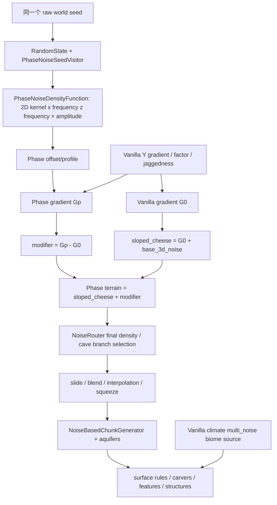

# WPH-016-01：四 Phase 空间地形重设计方案 C

状态：**设计提案 / legacy 实测基准；需要独立 review 后才能开始原型。**
关联：[Issue #34](https://github.com/fangbm/WorldPhase/issues/34)。本 PR 不关闭该 issue。
基线 main：`17f45a590f282f7275031a840c20260ba337539a`，MC 26.1、NeoForge
26.1.0.19-beta、Java 25。生产 Java、维度、density、noise settings 全部保持原样，
冻结 SHA-256 见 [protocol.json](verification/spatial-retune/v1/protocol.json)。

## 1. 决策与证据边界

采用 C：**共享空间骨架 + 各 Phase 自己的地形密度主体 + 可复用的 Vanilla 生态管线**。
不再要求四个世界都以 `overworld/sloped_cheese` 作为主要形态；也不重写 ChunkGenerator。
先做结构验证，再考虑参数。天空/环境单独验收，不能靠色彩滤镜让地形“通过”。

[WPH-015](MVP_PLAYTEST.md) 的结论继续有效：技术回归 PASS，`ROUTE_COMPLETED=0`，
RETUNE，Phase 2 NOT_APPROVED。WPH-013 useful-majority 失败、Hybrid Opening 设计、
SavedData 无可信 preset fingerprint 的限制均未解除。本方案没有实现 Anchor、出生重定向、
教程选择或渲染器。共享地形节点是候选结构，不是已安全、已可玩的路线。

本轮证据分三层：

- **实测**：原生 generator 的 base heights/columns、seeded router density、实际 GPU 客户端图。
- **诊断**：坡度/连通性等有限采样代理；不能证明完整地貌拓扑、碰撞安全或玩家可通过。
- **提案**：下文新数学表达、尺度和验收门槛；尚未生成这些新地形，不能当成结果图。

## 2. 现有生成链：实际做了什么

### 2.1 从 kernel 到地形



`PhaseNoiseDensityFunction` 是薄适配器，叶节点忽略 y。`RandomStateMixin` 在 router
mapAll 的接线阶段通过 visitor 绑定原始世界 seed；四 Phase 不是 seed+index。
`NoiseBasedChunkGenerator` 不变；所有 dimension type 是 `minecraft:overworld`，
biome source 是 `minecraft:multi_noise` / preset `minecraft:overworld`。

关键路径：`src/main/resources/data/worldphase/worldgen/density_function/`、
`worldgen/noise_settings/{smooth,ridge,cell,fracture}.json`、`dimension/*.json`；
`src/main/java/dev/fangbm/worldphase/worldgen/{noise,density,sample}/`。

### 2.2 sloped_cheese 的代数角色，不能仅看 JSON 中的 add

记 `q(n)=quarter_negative(n)`（负值乘 0.25，正值不变），
`Y(y)=y_clamped_gradient(-64,320,1.5,-1.5)`，
`O=overworld/offset`，`F=overworld/factor`，
`J=overworld/jaggedness × half_negative(noise(jagged,1500,0))`，`B=base_3d_noise`。

```text
G0(x,y,z) = 4 q((Y(y) + O(x,z) + J(x,z)) F(x,z))
sloped_cheese = G0 + B(x,y,z)
Gp(x,y,z) = 4 q((Y(y) + Op(x,z) + jp J(x,z)) F(x,z))
modifier = Gp - G0
Tp = sloped_cheese + modifier = Gp + B  (浮点舍入范围内)
```

因此“Vanilla 高度原封不动压过一个小噪声”不是准确解释。旧梯度被减去，Phase 梯度被加回；
真正共享的是 **factor、残留 offset / jaggedness、Vanilla 3D base noise、洞穴、气候、表面和生态语法**。
本轮独立接线采样 G0/Gp/B/Tp，检查这个等式，而非从函数名称推断贡献百分比。
Smooth 的 Gp 在 smooth_terrain.json 内联；其他三个使用独立 *_gradient。
四个Op的准确公共形式是 `Op=-0.55+rp*(O+0.55)+profilep`；表中保留比例rp
作用于以−0.55为基准的起伏，而不是把整个offset直接乘rp。

| Phase | 当前 2D 信号与 profile | 原 Vanilla offset 起伏保留 | jaggedness 比例 |
|---|---|---:|---:|
| Smooth | gradient，f=0.001，amplitude=0.10 | 0.35 | 0.35 |
| Ridge | ridged，f=0.002，2 octaves；2.4(r−0.82) | 0.50 | 0.60 |
| Cell | Worley F1，f=0.003；t=clamp(2(F1−0.18),0,1)，−0.16+0.95t³ | 0.20 | 0.15 |
| Fracture | 2D domain warp，f=0.002，amplitude=1.8，warp f=0.0015 / strength=1400 | 0.35 | 0.20 |

`offset` 是 density 空间的垂直参考，不是 block height。Y 的斜率约 −1/128，
所以 0.1 offset 对应约 12.8 格的简化零交点移动；factor、非线性、B、洞穴和 aquifer
都会改变实际表面，不能用这条换算预测最终高度。`factor` 在不同大陆/侵蚀区缩放密度梯度，
改变穿过零面时对 3D B 的敏感性；不是给高度再乘一个山高系数。
`jaggedness` 留下共享的山地细节，`offset` 保留大陆/谷地相关形态；其空间分布来自 Vanilla
terrain splines / climate routing，不是每个 Phase 自己的形态系统。

### 2.3 final router、洞穴与 surface/biome

当前替换不止 final density 的一个常数项：所有该分支的 sloped_cheese 引用被换成 Tp，
包括 range_choice 的输入及依赖 terrain density 的地下洞穴项。

```text
withEntrances = min(Tp, 5 * caveEntrances)
caveBranch = range_choice(Tp, -1e6, 1.5625, withEntrances, underground(Tp))
final = min(postProcess(slideOverworld(caveBranch)), noodle)
postProcess(d) = squeeze(0.64 * interpolated(blend_density(d)))
```

underground 内的 cheese/layer/spaghetti/pillars 沿用 Vanilla，含
`clamp(1.5 - 0.64*Tp,0,0.5)` 等耦合。`squeeze` 是有界非线性，不能拿 squeeze 后
的 amplitude 当地形高度。preliminary_surface_level 使用匹配的 Phase offset，
关系到 aquifer 的地表参考；barrier/floodedness/spread/lava、ore vein 路由仍是 Vanilla。
Noise settings 的高度 -64..319，水平 cell4、垂直 cell8、海平面63不变。

随后原生 generator 插值、填充 stone/water、执行表面规则，configured carvers、
features/ores、structures 继续走 Vanilla 管线。**有洞穴函数不等于所有最终洞穴来自它**；
carvers 还有独立阶段。locate village 成功也不等于建筑和村民安全，见独立 Issue #25。

气候 continents/erosion/depth/ridges 等槽仍沿 Vanilla，terrain-specific offset 不会自动重写
biome climate。森林、草地、石头、水、同样的海拔水位与相同天空，都会强化 Vanilla 相似感。
山地 biome 可覆盖变平地形；Smooth 海洋变浅仍是已知问题。环境方案不能掩盖这些问题。

### 2.4 为什么算法名字没有带来预期地貌

- **Ridge**：`1-abs(coherent)` 的各向同性脊线不保证方向、长度、相邻山墙或可通行狭谷。
  加 octaves 不会自动得到地质上的连续山脊。
- **Cell**：F1 是离最近点的半径，不是 Voronoi cell ID 或到多边形边界的距离。
  cubic clamp 倾向生成盆心/圆形坡面及饱和区，不能声称已实现蜂窝平台。
- **Fracture**：warp 只扭曲自定义 2D offset 的采样位置，没有将 Vanilla 3D terrain、洞穴或
  气候坐标一并扭曲；连续 warp 也没有明确断层面、岩层落差或裂隙体积。
- **Smooth**：削弱 offset/jaggedness 仍继承共同 B、factor、生态；“比较平”不等于有宽谷连续通道。

可继续 2D 的部分：大陆/共同海岸、谷地/山脊轴线、cell 分区、断层轨迹、台地高度、共享节点。
真正需要 y-dependent density 的部分：悬挑、洞顶/桥、封闭空间、垂直裂隙、错位岩体、体积厚度约束。
这些可以是解析几何的 3D density，不一定需要昂贵的全新 3D 随机噪声。

## 3. 客观基准与复现

冻结 [协议](verification/spatial-retune/v1/PROTOCOL.md) 与
[实测报告](verification/spatial-retune/v1/RESULTS.md)。三个固定 seed：
123456789、8675309、20261011；每 seed 两窗口 forest(-384,896)、highland(1344,1200)，
四 Phase + Overworld control，保留水域与差异不明显的区域，不替换失败/普通样本。

- 同坐标 33×33 / 64格 coarse、17×17 / 16格 fine height/slope maps；海面下仍记录海底实体高度。
- 高度分布、局部3×3起伏、坡度、方向张量、采样连通性、同坐标高度相关及 |Δh|≤4 代理。
- x/y、z/y 原生 base-column 剖面（air/water/lava/solid），并列 raw density planes 与三维体积切片。
- 原生 client30张统一截图：同坐标、y240、yaw135/pitch60、noon6000clear、1280×720、
  FOV70、视距16/sim5、Fancy基础（覆盖后UI为CUSTOM）/cloudsOFF/gamma0.5/particlesMinimal、Vanilla资源。

**不能混淆**：`TerrainSampleService` baseHeight 不含 surface/feature/structures；
`getBaseColumn` 也不是 FULL chunk。直接 finalDensity.compute 通过 marker 叶委托，
不是原生 NoiseChunk 插值结果；27处 native `getInterpolatedNoiseValue` 探针另列差值。
8格的密度剖面会漏掉小洞，不据此证明 topology 或通行。截图才是 FULL 渲染观察。

复现（Java25、已接受 EULA；工具不会擅自接受）：

```sh
./gradlew spatialBaseline
./gradlew spatialBaselineClient  # 原生显示环境，前一步生成的新测试存档
python -m pip install -r tools/spatial-baseline-requirements.txt
./gradlew spatialBaselineReport -PspatialPython=python
# 或 python tools/spatial_baseline.py --plots --require-native --archive
python -m unittest discover -s tools -p test_spatial_baseline.py
./gradlew coreRegressionAll build
```

只在 `run/spatial-baseline-v1/` 建新世界；不改旧 playtest 存档，不在 mod JAR 打包 probe。
数值/图片为有意归档的开发证据，不提交完整世界、运行目录或原始日志。
基准文件的 source hash 是审计锁，不是 SavedData 已验证的 transitive preset fingerprint。

## 4. 新 Density Function 数学契约（设计，不是已实现的地貌）

本节正式确定**符号、组合层次和安全边界**；数值是后续原型的首轮候选配置，按4.5节先冻结manifest
再实施/采样，不代表已经批准生产重构。`p=(x,z)`、`s=raw world seed`；世界坐标及H、长度、
宽度、厚度均为blocks。三维噪声参数顺序固定为(x,y,z)。`D>0`是实体侧、`D<0`是空侧、
`D=0`仅是界面，不能据此声称某个方块或玩家脚下安全。所有DF值无量纲。

统一记号：`S(a,b,v)=t²(3−2t)`，`t=clamp((v−a)/(b−a),0,1)`，要求b>a；
S连续且一阶连续。`N2_channel`、`N3_channel`是按同raw seed和不同稳定命名channel绑定的
coherent信号，均明确归一化至[-1,1]；原生NormalNoise按实际maxValue缩放，不假设天然是单位范围。
下文不带channel下标的N仍是**不同固定channel**，其ID/归一化方式必须逐项列入manifest，不能复用
可变随机状态或seed+PhaseIndex。既有PhaseNoise 2D接口、数学和goldens不变。

### 4.0 共享参考面、Dcommon 与组合层次

首轮共同骨架（所有Phase在同p使用相同seed、同holder与表达）：

```text
C(p) = clamp(vanillaContinentalness(p), -1, 1)
Hc(p) = sea_level + Ac*C(p) + ahc*N2_common(p/Lhc)
Dcommon(p,y) = (Hc(p)-y)/lambda
Dterrain(p,y) = (1-m(p))*Dcommon(p,y) + m(p)*DpCore(p,y)
```

这里vanillaContinentalness不是未定义的连续API：取已用raw seed接线的
`minecraft:overworld/continents`在整数(x,0,z)的raw DF值V00等，不请求chunks。
对非整数p，设bx=floor(x)、bz=floor(z)、tx=x−bx、tz=z−bz，定义
`V(p)=(1−tx)(1−tz)V00+tx(1−tz)V10+(1−tx)tz*V01+tx*tz*V11`；
四个V取(bx,bz)、(bx+1,bz)、(bx,bz+1)、(bx+1,bz+1)。C=clamp(V,−1,1)。
这是明确的C0双线性扩展，整数点与该raw分支一致，不冒充NoiseChunk插值或FULL地形；
Hc(qj)、warp后的q和节点包络因此都有定义，禁止偷偷对分数坐标取整。
首轮原型须记录这个参考分支/扩展版本及额外采样成本。

初值`sea_level=63, Ac=64, ahc=6, Lhc=900, lambda=16 blocks/density unit`，
故Hc∈[-7,133]。高度域为`y_min=-64 ≤ y < y_max=320`（y_max是排他上界）。
Dcommon在这个域的保守界为`[(Hc_min−y_max)/lambda,(Hc_max−y_min)/lambda]`，
首轮约[-20.4375,12.3125]；**不含独立3D细节噪声**。它是共享连续高度场的完整三维密度，
不是只比较一个高度值。海岸由未warp的共同C/Hc决定；新的coast spline只能另行冻结、版本化。

`m`在5.1节完整定义：公共核心半径Rcore内为0，外加16格影响带后为1；影响带内先留8格
共同collar，再用S混合剩余8格。collar算过渡影响面积，不偷算成扩大了的“核心”。
所有Phase特有山墙、bias、throw、rift和3D detail必须在`DpCore`内部求值，然后统一混合；
禁止混合后又加Phase特有项侵入核心区。

**站立层目标**是共享面下`Ts=16`格实体侧与面上`Aclear=4`格空侧，不是新增block平台。
单靠Dterrain还不够，必须在最后的density组合层保护这一带：

```text
down = Hc(p)-y
up   = y-Hc(p)
Py(p,y) = (1-S(Ts,Ts+vy,down)) * (1-S(Aclear,Aclear+vy,up))
P(p,y)  = (1-m(p))*Py(p,y)
Fnative(D) = min(postProcess(slideOverworld(caveBranch(D))), noodle)
Fcommon    = postProcess(slideOverworld(Dcommon))
Dfinal     = (1-P)*Fnative(Dterrain) + P*Fcommon
```

首轮`vy=16`，Py在`[Hc−16,Hc+4]`为1，在`y≤Hc−32`或`y≥Hc+20`为0，
两侧平滑过渡。`caveBranch`指2.3节含entrances/underground的显式Vanilla表达，不是公共方法名。
`postProcess`、slide的含义见2.3节；**Fcommon没有cave entrance或noodle**。
最终保护选择在noodle之后；两臂都已过相同postProcess/slide，不混用raw Dcommon与squeeze后的数值。
这套组合是未来要验证的DF设计，不是宣称当前26.1已有名为Fnative的可调用API。

因此，在核心/collar的中央保护带，四Phase的最终density表达均等于同一Fcommon；
在更深处恢复地下洞穴，而不是整根柱永久禁洞。Dcommon在`Hc−Ts≤y<Hc`为正、`y>Hc`为负；
原生插值/slide后的实际零面和有效实体厚度仍必须测量。节点只可在共享面和整个保护带远离顶底slide
的区域启用（首轮带边界须在[-40,240]内），且共同dry包络≥sea+8；不能通过clamp节点高度制造
突变平台。目标厚度Ts至少跨两个原生8格竖直cell；横向collar≥原生4格cell对角线与玩家footprint
的测试余量。此余量不是任意宽AABB的证明；更改noise cell尺寸时必须重新推导与验证。

`preliminary_surface_level`不能继续套用旧offset/factor的反解。后续原型用26.1
`minecraft:find_top_surface`（density、upper_bound、lower_bound、cell_height）
从**新的匹配density参考分支**计算地表估计：核心用Fcommon，其余用新Dterrain的明确无洞穴参考，
上界由各Hp及3D幅度推导、lower_bound=y_min、cell_height=8。`(1-m)Hc+mHp`只可作为
宏观参考/诊断；加上已证明的3D幅度及插值余量后才可构成上界，不能直接当aquifer或玩家安全地表。该估计、native interpolation和FULL地表的差异
须由fixture单列；不能只改final_density而留下不匹配的preliminary surface。

DF保护不阻止随后carver、aquifer、surface、结构、树木、实体和玩家改造，完整边界见5.2节。
任何声称“16格可靠实体层”的结果必须在真实生成列/FULL块中复核；这里先固定的是**密度层契约**。

新叶节点必须有codec/min-max bounds/mapAll/seed-binding单测。优先原生算子和seeded holders，
仅解析cell/fault几何确有需要时注册最小DF类型。当前visitor只识别PhaseNoiseDensityFunction，
新叶必须显式扩展seed binding，不会自动获得world seed。以下`DpCore`分别是Ds、Dr、Dcell、Df；
Cell腔体与Fracture裂隙的开关属于4.5节分步实验，不可把通用高度场公式当作所有体积几何的替代品。

### 4.1 Smooth：宽谷和通道，而非普通平原

以共同低频骨架 Hc、确定性的谷地线图 V 为输入，dV 是离谷线最近距离：

```text
Hv = Hc + 4 N2(p/900) - 8 exp(-(dV/64)^2)
Hs = Hv + 3 N2(p/220) * (1-exp(-(dV/64)^2))
Ds = (Hs-y)/lambda + 0.04 N3_smooth(x/80,y/48,z/80)
```

谷地宽48–160、连续长度至少256、间隔256–512，主起伏波长700–1200。
谷线取自下文共享 seed 图的子图，有明确出口，不靠阈值噪声偶然连通。
2D控制宽谷/缓坡/流向；小3D项只做岩体细节，Vanilla洞穴继续独立工作。
海岸 Hc 的过渡独立于谷深，避免把海底抬到同一薄层；首轮检查海洋深度分布。

风险：过平、谷地全被水占据、biome山地违和、细节噪声破坏步行通道。
验收：多条足宽可步行谷段、连续出口、仍有丘陵/水域；与Vanilla平原的盲辨和几何指标分开。

### 4.2 Ridge：有方向的连续山墙与狭谷

θ由稳定seed channel确定首轮全局主方向，n为法向、t为切向；区域缓变方向是单独实验，
不得在chunk或区域边界突然旋转。

```text
u = dot(p,n)/320 + 0.16 N2(p/600)
r = exp(-(sin(pi*u)/0.28)^2)
Hr = Hc + 48 r - 10 (1-r) + 4 N2(dot(p,t)/600, dot(p,n)/900)
wallMask(r) = S(0.10,0.30,r) * (1-S(0.70,0.90,r))
Vwall(p,y) = 1-S(16,32,abs(y-Hr(p)))
Mwall = wallMask(r) * Vwall(p,y)
Dr = (Hr-y)/lambda + 0.12 Mwall*N3_ridge(x/64,y/40,z/64)
```

r∈(0,1]（可安全扩至[0,1]）；wallMask∈[0,1]，C1连续。
谷地r≤0.10为0，山墙r∈[0.30,0.70]为1，顶部r≥0.90回到0；两侧平滑过渡。
Vwall只让距宏观表面≤16格处全幅生效，≥32格处为0；它不把整根山墙柱或谷地都加上3D噪声。
最终共享混合m/P会排除核心区的此项，不能在Dfinal之后再加回来。
首轮θ(s)=pi*u(s,0,0,0x5249444745444952)（u见4.3节），全局固定方向，n=(cosθ,sinθ)、t=(−sinθ,cosθ)；
区域缓变方向属于另一项冻结实验，不得在chunk边界重取θ。方向扰动幅度0.16及周期320仍是B类参数。

`|0.12*Mwall*N3|≤0.12`仅是detail界，不是整个Dr的min/max。
首轮Hr∈[−21,185]，y∈[−64,320)，故可声明Dr的保守界[-21.4325,15.6825]。
更改lambda/高度/幅度后必须重算并向外舍入浮点界；混合采用各臂区间包络，cave/min/max/postProcess后的界另行推导。
不能把2D/3D叶的单位范围误填为整条density的界。

脊线间隔256–512、半宽24–40、连续长度512+；方向扰动梯度限制，避免主轴折断。
2D负责长轴/狭谷/山高，3D只在山墙做局部台阶与浅悬挑；不把旧各向同性Ridged改名后当新结构。
原型先测平行脊，再测方向缓变，禁止一开始无约束warp。

风险：无限长屏障、所有相邻Phase高差大于4、山壁露出结构、洞穴入口消失。
在共享节点外保留鞍部/缺口，比较沿脊与跨脊路径，不把高std等同好山脊。

### 4.3 Cell：多边形盆地、台阶边界和平台

新增nearest-site ID和真正的Voronoi边界距离，不修改既有Worley F1。site来自全局格网：
`ID=(i,j)`为有符号整数格坐标，`qij=Lcell*(i+0.5,j+0.5)+jitterij`，
首轮Lcell=240，每轴jitter∈[−0.1Lcell,0.1Lcell)。ID不是遍历下标、chunk编号或随机表位置。
每个q只由(s,ID,site channel)确定，允许按ID缓存，不能按采样顺序分配。

为消除cellBias的自由定义，使用以下独立的版本化设计hash（不改WPH-003 NoiseHash）：

```text
M(v): u64 modulo 2^64
  v = (v xor (v >>> 30)) * 0xbf58476d1ce4e5b9
  v = (v xor (v >>> 27)) * 0x94d049bb133111eb
  return v xor (v >>> 31)
h(s,i,j,tag) = M(s xor M(i xor 0x9e3779b97f4a7c15)
                  xor rotl64(M(j xor 0xd1b54a32d192ed03),32) xor tag)
u(s,i,j,tag) = (h(s,i,j,tag) >>> 11) * 2^-53  # [0,1)，不取abs有符号long
cellBias(ID) = 2*u(s,i,j,0x43454c4c42494153)-1  # 无量纲[-1,1)
```

s/i/j按二补码位模式参与hash，乘法显式64位回绕，`>>>`为逻辑右移。
site x/z tags分别为`0x43454c4c58000001` / `0x43454c4c5a000001`；
jitter轴值=`0.1Lcell*(2u−1)`。bias独立channel不复用site jitter。
这些规则不依赖遍历顺序或PRNG状态，不能按chunk重新选点；负坐标使用floor(p/Lcell)。

q0为到p距离最小的site，等距时以ID的有符号(i,j)字典序取最小。
在已确定q0的Voronoi单元中，p到该单元边界的欧氏距离为：

```text
e(p) = max(0, min_{qj!=q0} (|p-qj|^2-|p-q0|^2)/(2*|qj-q0|))
     = max(0, min_{qj!=q0} (|qj-q0|/2 - dot(p-q0,qj-q0)/|qj-q0|))
b = 1-S(8,32,e)
terrace(e) = sum_k=0..2 [1-S(ek-beta/2,ek+beta/2,e)]/3
( e0,e1,e2 ) = (12,20,28); beta=3 blocks
biasWeight(e) = S(4,12,e)
Hcell = Hc + 6*biasWeight(e)*cellBias(ID) + 18*terrace(e) - 6*(1-b)
Dsurface = (Hcell-y)/lambda + 0.03*N3_cell(x/100,y/60,z/100)
```

e以blocks计；分母site间距离不是F1或F2的差。min遍历所有可能限制单元的site，不假定第二近点
就是最近边界。q不重合；等距边界e=0，无论哪侧ID，都有biasWeight=0，故bias不制造密度跳缝。
优先计算第二种局部差向量形式以减少大坐标的平方相减损失；最后max(0,…)只钳制舍入负误差，
不容许用它掩盖选错q0。e在边/顶点连续但不要求处处可微，ID则本来在边界变化。

原始bias*6是每单元[−6,+6)格偏移，相邻内部平台的bias差<12格；近边界平滑归零。
它可升降盆底/平台，但不能凭ID改变Voronoi边界几何。terrace是原round示意式的明确连续替代：
每阶6格，e=12/20/28附近以3格bevel过渡。b仍控制盆心的−6格项。上述是首轮候选参数，不是生产调参。
cell典型直径160–320格；jittered Voronoi不保证规则六边形，辨识度必须从实际单元网络验证。

可选3D腔体的完整原始表达为每个启用site的椭球：

```text
Ej(p,y) = |p-qj|^2/45^2 + (y-(Hc(qj)-24))^2/10^2 - 1
Dcell = min(Dsurface, min_enabled_j Ej)
```

首轮`cell_cavities=false`，故DpCore=Dsurface。以后启用前须单独冻结owner选择与邻域界：
Ej以全局site ID定位，min所有可能相交的启用腔，而不是随nearest ID跳换一个Ej；无启用腔时不加min项。
仅允许`Hc(qj)−24−10≥sea+8`且顶/底厚度通过密度及FULL验证的候选腔，不把dry高度判据当安全证明。
近共享节点的影响仍由m/P消除，carver/FULL风险另验。椭球负内正外，是真正y相关体积；
不能把封闭空间图当可进入路线，门户/入口仍未证明。

邻域搜索必须证明覆盖q0、所有可能限制e的site，以及启用后的腔体，不能照抄F1的3×3假设。
7×7只是首个参考oracle尺寸候选，不是本轮已证明充分；后续实现前给出几何界或扩大参考集以证明结果，
固定等距/负坐标/chunk边界用例与操作上限。不能把F2−F1无说明地冒充精确边界距离。

风险：台地饱和、边缘过陡无出口、腔体浸水/薄顶、邻域遗漏与昂贵采样；分别实测平台面积、
边界长度、单元/门户，不仅看圆坑数量。尚未启用或验证的腔体不得标成已可玩的Cell区域结构。

### 4.4 Fracture：基础地形、有限断层和裂隙体积

**Hf的定义与坐标系。** 未断裂的自有基底以共同Hc为骨架：

```text
Hf(q) = Hc(q) + aF*N2_fracture_macro(q/LF) + bF*N2_fracture_local(q/lF)
wx(p) = Aw*N2_warp_x(p/Lw); wz(p) = Aw*N2_warp_z(p/Lw)
q = p + (wx,wz)
Hbase(p) = Hc(p) + Hf(q)-Hc(q)
         = Hc(p) + aF*N2_fracture_macro(q/LF) + bF*N2_fracture_local(q/lF)
Q = (q.x, y-T(p), q.z)
Tf(p,y) = (Hbase(p)+T(p)-y)/lambda + A3f*N3_fracture(Q.x/L3,Q.y/L3,Q.z/L3)
```

首轮`aF=12,bF=6,LF=640,lF=192,Aw=96,Lw=640,A3f=0.12,L3=64`。
Hf是未断裂的height场，Hbase只warp其**自有起伏**，以Hc(p)−Hc(q)补偿共享大陆面位移；
不会把海岸/海平面随整套Vanilla climate一起扭曲。两个warp channel独立且稳定。
原型前验证水平warp的Jacobian扰动上界≤0.35（不能只测少量点就声称证明），不满足则该配置不准执行。
这没有给旧2D kernel加新维度；新体积来自下述断层/裂隙及Q.y参与的3D detail，必须做关闭这些项的ablation。

**有限fault trace。** 每条trace的全局ID、起点a、单位切向t、法向n=(−t.z,t.x)、长度L、
方向及启用规则由raw seed/稳定channel和manifest确定；首轮只用直线段，不在chunk内重抽方向。
`l=dot(p−a,t)`是未clamp的沿线坐标、`f=dot(p−a,n)`是带符号横距，二者单位blocks。
不能把l夹到[0,L]，否则端点外endCap永不变正。多trace都用同一全局定义，查询邻域必须证明完整。

```text
a(l) = S(0,E,l) * (1-S(L-E,L,l))
bfault(f) = 1-S(B,B+F,abs(f))
v_i = a(l_i)*bfault(f_i)
T(p) = (tau/2) * sum_i [v_i*tanh(f_i/w)] / max(1,sum_i v_i)
```

首轮`L=384,E=64,B=48,F=48,tau=32,w=4`。a和bfault是C1连续的有限包络，
trace端点外或横向≥96格时贡献为0；多trace归一化使`|T|≤tau/2`，不因交叉无限叠加。
trace从全局格网按局部有限邻域生成：首轮间距512、每格一候选，中心为格中心加每轴±64格jitter；
x/z tags为`0x4641554c54580001` / `0x4641554c545a0001`，方向角为
`2*pi*u(s,i,j,0x4641554c54444952)`，起点a=center−L*t/2。不按最近trace硬切换。
归一化使采样顺序不影响数学定义；实现累加按ID排序固定浮点顺序。

单trace两侧在包络内部约相差tau，正T抬升、负T下移，Q.y=y−T对同一岩体3D细节做相同竖直位移。
远离trace后T回0，Hbase没有全图负常数；不会把整个Fracture半平面永久下沉。
有有限断层落差不等于可走，斜坡/边缘的危险必须实际观察。

**裂隙参数、干燥准入与闭合。** `riftWidth`是**半宽**，首轮8格（全宽16）；长度L与fault共用。
对每条候选trace定义封闭水平足迹Ω（长度L、最大半宽riftWidth，含8格外侧验证余量）。
Hlo/Hhi是Ω上Hbase的保守下/上界：不能以稀疏样本min/max冒充连续界，需解析界、
带已证明导数界的网格包络或更保守估计；无法界定的trace关闭裂隙。

```text
riftBottom = Hlo - depth                # depth初值24格
riftTop    = Hhi + tau/2 + headMargin    # headMargin初值8格
endCap(l) = ((l-L/2)/(L/2))^2 - 1
Rplan(p) = (f/riftWidth)^2 + endCap(l)
Rift_i(p,y) = max(Rplan, (y-riftTop)/kappa, (riftBottom-y)/kappa)
```

`kappa=8 blocks/density unit`，Rift无量纲。riftBottom/Top是每条trace的常量高度，满足
`y_min+8≤riftBottom<riftTop≤y_max−8`；首轮还要求**整个底界≥sea_level+8**。
不满足则整条裂隙关闭，不把底界强行clamp到海平面以掩盖漏水。关闭裂隙不自动改变throw；
throw与裂隙分别冻结/做ablation。局部aquifer可高于海平面，上述准入仍不是“已无水”的证明。

endCap在(0,L)为负、端点为0、外部为正，C∞连续。Rplan<0为有限椭圆足迹：
横截半宽为`riftWidth*sqrt(1-((l-L/2)/(L/2))^2)`，向端点逐渐收至0。
因此不是横向恒宽裂隙在端点突然截成整面岩墙。max组合连续但交棱只C0；
原生插值/方块离散仍可能产生细柱、端部台阶，必须看剖面与FULL，不能由连续公式宣称没有生成瑕疵。

```text
Mrift = max(1, Tf的已推导maxValue)
Rift = min_enabled_i clamp(Rift_i,-1,Mrift)  # 无启用trace则取Mrift
Df = min(Tf,Rift)
```

Rift_i≥−1；上界钳至Mrift不改变min(Tf,Rift_i)结果，提供有限codec bounds。
Df保守界为`[min(Tf_min,−1),Tf_max]`。首轮Hbase∈[-25,151]、|T|≤16，故Tf的可用保守界为
[-22.6825,14.5575]，Mrift=14.5575；更改任何B项必须重算，不写死到codec。邻域剔除必须证明遗漏trace的Rift_i≥Mrift，
不能只以“已经在裂隙负区之外”剔除；正值仍可能影响插值。候选数量/邻域界需在实施前冻结并验证oracle，
超预算失败不能静默丢trace。单元ID和函数均来自世界坐标，不能在chunk边界重置。

这是正实体约定下的正确挖空组合：Rift<0且Tf>0时，min令实体变空；
y低于bottom或高于top时，对应项>0，不能把原本Tf>0变成负值；横向/端点外同理。
端点/上下界等号处是0界面，不计“安全实体”。多裂隙以min实现空体积并集，
用max(Tf,Rift)会反过来填实裂隙，禁止混淆。

可手算例：Hlo=100、Hhi=108、tau=32、depth=24、headMargin=8，所以bottom=76、top=132；
L=384、半宽8、kappa=8。此符号例取rift-only ablation，T和3D detail关闭，Hbase=104；Hlo/Hhi是包含104的保守界。

| 点(f,l,y) | Rplan / 竖直项 | Rift | Tf | min后的符号 |
|---|---|---:|---:|---|
| (0,192,100) | −1 / −4 / −3 | −1 | 0.25 | −1，挖空 |
| (16,192,100) | 3 / −4 / −3 | 3 | 0.25 | 0.25，侧外保留实体 |
| (0,192,68) | −1 / −8 / 1 | 1 | 2.25 | 1，底界外不挖空 |
| (0,392,100) | 约0.0851 / −4 / −3 | 约0.0851 | 0.25 | 正，端点外闭合 |
| (0,192,140) | −1 / 1 / −8 | 1 | −2.25 | 原本为空，不是裂隙额外挖空 |

同一trace中部y=132时Rift=0；l=0/L且f=0时也是界面，不当作支撑面。
Df只在DpCore内部，外层m/P使核心区最终回到Fcommon，裂隙不得在共享保护之后再次min进Dfinal。
裂隙低于海平面、跨海岸、与perched aquifer/邻洞连通的湿实验**首轮关闭**；保留未warp的共同海岸与
匹配preliminary surface，只能降低异常水墙风险。FULL中的水体、后续carver和实体风险仍须验证。
Vanilla气候/洞穴/aquifer坐标暂不warp；不包装任意DF context去扭曲cache/interpolated语义。

### 4.5 A/B分类、首轮参数清单与冻结流程

**A：本轮确定的架构约束。** 同raw seed/稳定channel、全局ID/等距规则、坐标/单位/正负号、
Dcommon无独立3D噪声、共同面与Phase自有形态分离、P在最后noodle之后选择同数域共享分支、
rift正外负内/min挖空与有限闭合、bias边界归零、core/影响面积分计、真实FULL动态验证及正常±4不变。
4.3节hash与tags是该提案版本的可复现定义；改变它们必须新generation版本。
这些是设计契约，不是已经实现或已证明路线可玩的结论。

**B：仍待原型选择的数值/功能开关。** 下表给出首轮候选的固定值，非生产默认值。
所有B项都影响几何、洞穴或地表估计，**都影响worldgen兼容性（表中统一为“是”）**；
改变任何一项须新manifest/profile ID、新测试世界与新证据，不能覆盖旧settings ID。
单位除注明外都是blocks；向量的范围和值按名称同序对应。

| 参数 | 合理初始范围 | 首轮固定候选 | 形态影响 | 安全/兼容风险 |
|---|---|---|---|---|
| C1旧noise amplitude统一倍率k | 1.05–1.25 | 1.10 | 仅测旧信号强度变化 | 高度/水域可能变差，不是最优控制；兼容是 |
| Ac / ahc / Lhc | 48–80 / 0–8 / 700–1200 | 64 / 6 / 900 | 共同大陆起伏 | 海岸/节点dry变化；兼容是 |
| lambda | 12–24 blocks/density unit | 16 | 零面梯度/细节敏感度 | cave阈值与surface estimate；兼容是 |
| Lnode / delta | 256–512 / 0..Lnode/8 | 512 / 64 | 节点密度/jitter | 图断连、邻域证明；兼容是 |
| Rcore / Wtransition / halo | {8,16,24} / 16–32 / 8..Wtransition−4 | 16 / 16 / 8 | 核心与影响带 | footprint/插值/过渡陡壁；兼容是 |
| Ts / Aclear / vy | 16–24 / 4–8 / 8–24 | 16 / 4 / 16 | 地板壳与头顶保护 | carver/液体不能自动保证；兼容是 |
| dryMargin / nodeSlopeMax | 8–16 / 1/16..1/8 | 8 / 1/8 | 节点启用 | 候选不足/包络误判；兼容是 |
| z边保留概率 / edge形状 | 0–0.5 / 直线或后续曲线 | 0.35 / 直线（x边全保留） | Smooth谷图连通 | 边不是路线证明；兼容是 |
| Smooth a宽波 / 谷深 / 小丘幅 | 0–8 / 4–12 / 0–6 | 4 / 8 / 3 | 缓谷/丘陵强度 | 过平/淹没；兼容是 |
| Smooth宽波L / 小丘L / 谷宽参数 | 700–1200 / 160–320 / 48–80 | 900 / 220 / 64 | 谷/丘尺度 | 窄路/水道阻断；兼容是 |
| Smooth A3 / Lxz / Ly | 0–0.08 / 64–128 / 32–64 | 0.04 / 80 / 48 | 岩面细节 | 孔洞/落差；兼容是 |
| Ridge方向模式 | 全局seed方向；区域缓变另臂 | θ(s)=pi*u，单全局方向 | 连续主脊 | 区域过渡断脊；兼容是 |
| Ridge周期 / u扰动幅 / 扰动L | 256–512 / 0–0.20 / 400–800 | 320 / 0.16 / 600 | 脊线间距/弯曲 | 分叉/屏障；兼容是 |
| Ridge profile宽参数 / 山高 / 谷深 | 0.22–0.35 / 32–64 / 6–16 | 0.28 / 48 / 10 | 脊宽/山墙 | 高差过大；兼容是 |
| Ridge沿线幅 / 切向L / 法向L | 0–6 / 400–800 / 700–1100 | 4 / 600 / 900 | 沿线变化 | 鞍部消失；兼容是 |
| wallMask四阈值 | 0.05–0.15 / 0.25–0.35 / 0.65–0.75 / 0.85–0.95，严格有序 | 0.10 / 0.30 / 0.70 / 0.90 | 山墙定位 | 噪声侵入谷/顶；兼容是 |
| Vwall内/外带 | 12–24 / 24–48，外>内 | 16 / 32 | 细节竖直范围 | 洞顶/悬挑；兼容是 |
| Ridge A3 / Lxz / Ly | 0–0.20 / 48–96 / 32–64 | 0.12 / 64 / 40 | 墙面3D细节 | 薄壁/洞口；兼容是 |
| Lcell / jitter比例 | 160–320 / 0–0.10 | 240 / 0.10 | 多边形尺寸 | 邻域/跨界一致性；兼容是 |
| Cell bias幅 / bias淡入内/外e | 0–8 / 2–6 / 8–16 | 6 / 4 / 12 | 盆/平台各单元高差 | 边界跳缝；兼容是 |
| Cell b的内/外e | 4–12 / 24–40 | 8 / 32 | 盆缘宽度 | 窄平台/陡边；兼容是 |
| Cell台阶总高 / 盆深 / bevel beta | 12–24 / 4–10 / 2–4 | 18 / 6 / 3 | 平台与边缘 | 不可攀/薄顶；兼容是 |
| terrace的e0/e1/e2 | 10–14 / 18–22 / 26–30，bevel不可相互覆盖 | 12 / 20 / 28 | 三阶位置 | 台阶离散/通行；兼容是 |
| Cell A3 / Lxz / Ly | 0–0.06 / 80–128 / 48–80 | 0.03 / 100 / 60 | 岩面细节 | 腔体/支撑；兼容是 |
| cell_cavities / 腔半径/半高/下移 | false或独立true臂 / 32–56 / 8–12 / 20–32 | false / 45 / 10 / 24 | 封闭空间 | 启用前冻结owner、邻域、屋顶/水体准入；兼容是 |
| Fracture aF/bF / LF/lF | 8–20 / 0–8 / 512–896 / 128–256 | 12 / 6 / 640 / 192 | 自有起伏 | 不以高度噪声替代fault验收；兼容是 |
| Aw / Lw | 64–192 / 384–768 | 96 / 640 | 水平坐标变形 | Jacobian约束需预检；兼容是 |
| Fracture A3f / L3 | 0–0.20 / 48–96 | 0.12 / 64 | 错位岩体detail | 碎洞/悬挑；兼容是 |
| fault格距 / jitter / L / E | 512–1024 / 0..格距/8 / 256–768 / 32–96且2E<L | 512 / 64 / 384 / 64 | trace密度/长度/闭合段 | 交叉/端部墙；兼容是 |
| B / F / tau / w | 32–64 / 32–96 / 16–48 / 2–8 | 48 / 48 / 32 / 4 | 局部throw与回归 | 负侧跌落/大范围沉降；兼容是 |
| riftWidth（半宽） | 4–12（全宽8–24） | 8（全宽16） | 裂谷口宽 | 掉落/跨越；兼容是 |
| depth / headMargin / kappa | 16–40 / 4–12 / 4–16 | 24 / 8 / 8 | 裂隙上下界/梯度 | 薄底/水墙；兼容是 |
| 裂隙底界dry margin | 8–16高于sea_level | 8 | 湿裂隙排除 | perched aquifer仍须FULL查；兼容是 |
| throw / dry_rifts / wet_rifts开关 | 三个独立bool，wet首轮禁用 | F0=true/false/false；F1=true/true/false | fault-only对照dry裂隙 | F1无合格trace必须如实FAIL/未覆盖；兼容是 |
| 新N3的noise parameters | 单octave起步，后续变更另臂 | firstOctave=0、amplitudes=[1.0]，按maxValue归一化 | 原型微细节频谱 | 频谱改变零面；兼容是 |

N2首轮候选为既有GradientNoise的独立角色channel适配（不改kernel），N3用原生seeded NormalNoise
holders，噪声角色以`worldphase:prototype_v2/<phase-or-common>/<role>`逐项展开为唯一ID，
这些名字只是未来manifest的命名约定，本轮没有注册；channel tags、hash版本、seed binding及浮点求值顺序同样要展开。
其他最小运行条件也必须显式填满：全局ID/tags的实现与本节数学编码对应证据、
Voronoi/edge/fault查询半径和最大操作数、Hc/Hbase包络与导数证明、minValue/maxValue、preliminary surface表达。
这些**尚未冻结的实现绑定/证明是原型开工前的阻塞项**，不能靠默认值或本设计获批自动跳过。
这些是实现绑定/完整性证明，不是可在看到地貌后调节的额外自由度；
补齐它们不能暗改A契约或本表B值。邻域上限必须由几何证明确定，本轮不伪填一个已证明有效的数。

冻结流程（在看新地貌结果之前完成）：

1. 原型PR先提交版本化实验manifest与配置commit，注明A契约版本、全部B值、算法/holder/hash ID、
   bounds/预算证明、变更的DF/JSON及递归依赖摘要范围；任何自由变量、未经验证邻域界或Jacobian约束不通过则不能生成数据。
   首轮候选若预检失败，可在**未观察新地形前**修订并review新的manifest，不允许运行中自动缩放/丢节点。
2. 每个实验至少三臂：**Legacy v1原样**、**只修改旧噪声系数的控制组**、**新density架构组**。
   C1首轮仅把旧noise amplitude乘1.10：smooth 0.10→0.11、ridge/cell 1.0→1.10、
   fracture 1.8→1.98；frequency/octaves/warp与所有profile/gradient保持legacy。
   这是未来隔离fixture的预注册候选，不修改本PR或生产preset，也不代表旧方案已被最佳调参。
   控制组也须单独manifest/新存档；后续比较其他系数只能新增臂，不事后换掉C1。
   新架构组再按预注册开关比较无3D/有3D、fault-only/dry-rift等；禁止事后把ablation拼成成功样本。
3. 同raw seed、相同window/坐标/高度域、相机、6000/clear、中性Vanilla天空和画面设置；
   每臂新建独立存档，禁正式环境特效；数值、剖面、FULL与原生图分别记录。
4. manifest先review并冻结commit/hash，再生成首批测试数据；数据引用准确manifest版本、source head和toolchain。
   想改参数必须新增manifest/arm/新世界，保留旧结果，不覆盖或补写旧协议。
5. holdouts在实验配置冻结前不得打开或用于调参；解封验证后任何再调参都使该组成为开发集，需另定独立holdout。
   旧版基准与新实验分目录；不得重写本轮V1协议、104文件证据摘要或把旧图算新地貌结果。

## 5. 共享切换节点的完整契约

共享raw seed不代表Hp接近。节点是**密度层可比较结构**，不是自动生成的安全传送平台。
以下公共规则在四Phase相同；不修改`BOUNDED_LANDING`的±4。

### 5.1 确定性位置、连续距离场与面积预算

使用4.3节h/u及新tags，`ID=(i,j)`为全局有符号格网坐标，`Lnode=512`，
`cij=Lnode*(i+0.5,j+0.5)+delta*(2ux−1,2uz−1)`，首轮delta=Lnode/8=64。
node x/z tags是`0x4e4f444558000001` / `0x4e4f44455a000001`，不与site/bias/warp复用。
不从chunk坐标初始化PRNG，所有Phase以同样raw seed、floor和ID计算，故负坐标/跨chunk不改变节点。

`eligible(ID)`是**每节点常量**：在闭圆盘`|p−c|≤Rcore+Wtransition`上取得Hc的保守包络，
要求下界≥sea+dryMargin（首轮8），保护带在[-40,240]内，且共享面坡度的可靠上界≤1/8。
包络/导数界必须可追溯；离散高度样本仅可做筛选，没有已证明误差界时标记未验证，不准称eligible。
这个静态准入只筛掉海边/陡面/高度越界，不检查真实方块，不能等同SHIFT_POSITION_FEASIBLE。
不能按每个p或每个Phase临时开关dry mask，否则会在同一节点边缘产生不一致的突变。

令d为到eligible节点的最小水平欧氏距离；无影响节点时d可直接饱和为Rcore+Wtransition。
首轮`Rcore=16, Wtransition=16, halo=8`，规定0<halo<Wtransition：

```text
m(p) = S(Rcore+halo, Rcore+Wtransition, d(p))
```

公共核心d≤Rcore：m=0；过渡带前8格collar仍m=0，后8格连续变为1；外部为各Phase完整DpCore。
collar保护插值/AABB余量而非扩大宣称的核心覆盖率；P的竖直带见4.0节。
Dcommon在邻域内全局定义，Fcommon不能依赖不同Phase的洞穴/旧chunk数据。当前只讨论新测试世界；
旧存档/混合blender历史不能套用核心相等结论。

对本轮Lnode≥256、delta≤Lnode/8、Rcore≤24、Wtransition≤32的约束，
查询floor(p/Lnode)所在cell的3×3节点足以包含所有影响半径内节点：外圈可能中心最少距p
1.5Lnode−delta≥1.375Lnode，远大于最大影响半径56。要找的是**有界影响节点**，不是在dry mask
删除大量节点后无限搜索最近eligible节点；若3×3没有影响节点，m=1。欧氏距离及S以全局坐标求值，
重叠时取min（连续、交界可能不可微）；不按chunk裁切距离场或提前归零。改变这些界必须重新证明邻域。

保留Reviewer `9105d5f`的面积修正，r在下列预算中仅指以blocks计的Rcore：

- 对理想256格方格网，r=8/16/24时核心圆盘覆盖率约**0.31%/1.23%/2.76%**；
  512格间距再降至四分之一（未考虑dry mask与jitter边缘效应）。
- **核心面积**与**核心+过渡影响面积**分别报告，后者按Rcore+Wtransition的圆盘并集统计，
  包含collar，不能把两者都称为核心。以256间距、额外16过渡带为例，总影响约2.76%/4.91%/7.67%。
- **5–15%仅作为核心+过渡影响区域的探索性上限而非目标命中率**；不得为了凑比例增加节点。
  dry mask后报告实测并集、enabled/disabled数量、连通分量及Phase辨识度。

基础图连接轴向邻居（端点ID排序后唯一命名）。Smooth首轮保留全部x向边，z向边按
`u_edge<0.35`取子集，边的有序端点为(i1,j1)<(i2,j2)，
`hEdge=M(s xor 0x454447455a000001 xor M(i1) xor rotl64(M(j1),16)
xor rotl64(M(i2),32) xor rotl64(M(j2),48))`，`u_edge=(hEdge>>>11)*2^-53`。
谷地dV为到这些有限线段的最小距离。
仅连接两个eligible端点；没有可用边时dV=+∞，exp项为0，不擅自扩半径/绕过dry mask重新连线。
几何图/分支概率/邻域证明及浮点累加顺序都要进manifest，缺边意味着连通性可能失败而非实现随机漂移。

### 5.2 哪一层保护地板，哪一层仍可能破坏它

| 阶段 | 契约与保留风险 |
|---|---|
| Dcommon / m / DpCore | 核心与collar共享同一无3D噪声高度场；Phase细节、cell bias、throw、rift都在被替换的臂内 |
| Density entrance / cheese / spaghetti | Fnative中正常运行，但P=1的中央保护带由Fcommon替代；深处P=0保留洞穴 |
| Density noodle | 必须在其min之后应用最终共享选择，不能保护后又min(noodle)把地板切穿 |
| slide / blend / interpolation / squeeze | 两臂处在同一输出数域；新世界实际插值零面/厚度须验证，cell/halo尺寸改变就重验 |
| preliminary surface / aquifer | 匹配新的density参考（4.0节）；原生aquifer可能把负density填水/熔岩，dry Hc不保证实际无液体 |
| configured carvers | 后续AIR carving不受DF mask自动约束，可能破坏地板/洞顶；本设计不声称已屏蔽它，也不擅自改Biome/carver或回填平台 |
| surface / features / structures | 泥土/雪/植被、树与建筑可改变支撑/头顶空间或危险性，#25风险不因同density消失 |
| entities / edits / fluid ticks | 玩家宽度、实体占位、放置/破坏、液体更新等动态情况始终须当次真实检测 |

DF层能给出共同的预期岩体/保护壳，不能直接约束所有后续生成阶段。若FULL证明carver持续破坏节点，
应记录节点不可用，另行review最小carver保护方案；不得在本设计PR实现carver修改、自动补台或关闭所有洞穴。
核心至少Ts格实体侧及Aclear空侧是**实际生成列/FULL须复核的目标**，不是对任意位置的已证结论。

### 5.3 节点状态与动态重验

固定p只作为候选中心；根据真实玩家完整AABB确认其横向footprint及支撑位于可验证区域，
不可只测一个block。按现有服务准备目标chunks，用两个真实ServerLevel、实体/方块collision shapes、
脚下支撑、液体、危险、WorldBorder/高度检查，并调用同一SafeLandingResolver。
仅两Phase都能按相同double x/z、正常±4落点契约通过才标`SHIFT_POSITION_FEASIBLE`，记录方向及最终y。
正向成功不自动证明反向可行；双向声称要从实际抵达位置复测返程。

玩家放置/破坏、实体移动、液体变化或重载后，之前的验证只是历史证据，不能作为免检通行证。
每次transfer依旧重新执行现有LandingSafety/Service检查；不实现缓存安全令牌，不改SavedData或TransferPolicy。
`|baseHeightA−baseHeightB|≤4`、相同raw density、节点eligible都不等于可安全Shift。

### 5.4 从两个节点到有用路线

预注册A/B两个端点和目标：源Phase中A→B受明确山墙/断层等障碍阻挡，另一Phase提供可解释的
谷道/平台通路；先在A合法切入，Survival实际行走到B，再合法切回或完成既定访问目标。
两个端点的FULL安全、通路中间及返回都要验证，不从图的边或端点高度推导整条路径连通。
dry mask删除节点/边时不自动fallback到低质量位置；缺端点/出口就是该路线的失败原因。
只有正常入口、行走、出口/目标条件真实完成才标`ROUTE_COMPLETED`，不得靠DEV_SURFACE、飞行或
无限地表搜索补成功。共同图不是所有Phase相同的安全高速路；它提供对照试验机会而非路线证明。
受控Anchor Station仍属Hybrid Opening的未来独立方案，本轮不放置结构或改变出生。

## 6. Vanilla 保留边界与风险控制

| 子系统 | 原型边界 | 必测项 |
|---|---|---|
| Biome climate | 首轮维持Vanilla multi_noise与climate槽，控制变量 | 同坐标biome、山地/平原错配；depth改路由另开实验 |
| Caves | 地形输入改为Dterrain，保留Vanilla grammar，按4.0节保护共享带并记录分支 | 表层开洞、洞顶厚度、入口、noodle、carver阶段 |
| Aquifers | 保留native实现与seed，重做匹配的surface estimate | 海岸/裂隙水墙、浅海、封闭腔水、lava |
| Surface/ores/features | 复用原管线 | grass/dirt/stone、雪线、矿脉、树穿透/悬空 |
| Structures/entities | 不承诺旧布置安全，保留风险追踪 | 实际村庄/村民，不能只locate；#25不在此修复 |
| Blend/interpolation | 原生wrapper仅在正确接线阶段使用 | raw/interpolated/FULL差异、边界、min-max bounds |
| Server/client | 世界生成公共逻辑无client依赖 | dedicated cold/reload、classloading、无渲染器JAR泄漏 |

## 7. 分阶段独立 PR 与停止条件

| PR阶段 | 实施范围 | 交付与继续条件 |
|---|---|---|
| 1 本轮 | unchanged基准、源码归因、设计和环境API审计 | 三seed完整数据与原生图；review数学/风险；本轮不写生产原型 |
| 2 Smooth/Ridge | 最小新地貌算子+隔离v2原型，legacy/系数控制组并列 | 新存档，neutral-sky地形门槛、谷/脊结构、seed/codec/性能通过 |
| 3 Cell/Fracture | 真边界/断层解析密度，分步开3D腔/裂隙 | 新存档，负坐标邻域oracle、剖面/水体/实体安全和辨识度通过 |
| 4 环境 | 数据属性优先；独立client sky/cloud renderer仅限单独批准的隔离实验 | [环境方案](PHASE_ENVIRONMENT_ART_DIRECTION.md)，低配关闭路径/无闪烁/服务器安全；不得因地形视觉PASS绕过Phase2 NOT_APPROVED，正式renderer发布须单独准入 |
| 5 路线与性能 | 冻结路线、holdout、真实生存/重复Shift、结构风险 | 分别报告terrain/environment/gameplay；可RETUNE/STOP，不靠自动测试宣布GO |

每一步最多两轮预注册结构/尺度试验，之后review原因再继续，避免无限调参。
若共同节点使地貌失真、±4仍不能支撑有效路线、性能超预算，暂停扩展，比较减少Phase、
受控路径/Hybrid Opening等设计选项；不偷偷放宽正常传送。

## 8. 存档、区块接缝与版本管理

**每个实验arm新建存档**，分别标注seed、variant、版本和preset依赖；禁止复用旧世界覆盖设置。
开发基准不会删旧存档；缺数据/摄像机遮挡/失败均非零退出并保留记录。

后续新增不可变settings IDs（示例`worldphase:prototype_v2/ridge`，不是本轮已注册内容），
测试dimension映射独立受控：仅新实验存档的隔离datapack把现有四dimension keys指向版本化settings，
不新增业务PhaseId、不修改PhaseDefinition，保留legacy v1资源。生产升级需明确兼容策略，不能更新相同ID
就认定世界迁移成功：已有chunk保持旧方块，未生成chunk使用新密度，形成山墙、水墙、洞穴断口、
结构截断；Vanilla blending不能自动保证任意自定义density连续。只重置一个Phase会破坏共同图。

升级建议：备份旧存档→新独立世界验收→用户显式选择新世界；若未来做迁移工具，另开设计。
不自动替换SavedData选择，不把searched当selected。

可靠provenance应涵盖递归解析后的settings/DF/noise/biome/surface/structure依赖、实际datapack
优先级及内容、mod与toolchain、seed、schema和算子版本；规范化后生成摘要并记录无法覆盖项。
本轮文件SHA仅锁定本仓库基准输入，**不解锁SavedData自然候选验证**。旧证据在seed、配置、
评分/生成版本、preset或依赖变化时重新验证，shift-feasible也不等于route-validated。

## 9. 预先冻结的独立验收标准（后续原型）

### 技术与地形

- 既有goldens、同seed确定性、registry/codec、cold/save/reload、dedicated、真实碰撞测试继续通过。
- 同本轮三seed/两窗口完整采样，加预留holdouts：606102026、-77331057、424242424242。
  新原型不得先看holdouts再改参数；失败样本不可换seed/镜头。
- 地形盲辨：neutral sky、相同材质/时间/相机、去除Phase UI，四类标注准确率目标总体≥80%、
  每Phase≥70%；至少两名独立评审，记录n、混淆矩阵及样本，不声称本轮已做。
- Ridge：每seed至少两条≥256格连续脊，几何长宽比≥4，有谷/鞍部；方向张量只是辅助。
- Cell：每seed至少三完整相邻多边形单元，平台/边界可辨且有入口，不以圆形F1图替代。
- Fracture：每seed至少两可追踪≥256格断层/裂隙，有可测落差和3D剖面；禁warp对照证实因果。
- Smooth：每seed至少两条宽≥32、长≥256的连续缓谷段，有出口；保留丘陵/水体，非整图平板。
- 这些几何指标使用≤8格格网+实际FULL观察确认，不能直接用本轮64格基准宣称通过。

### 环境（独立）

天空/云/音效不依靠地形标签可辨；特效关闭仍清晰可玩；不增加危险遮蔽，不改变mob/bed日夜逻辑。
高/低配分档、灰度/色觉/光敏检查、frame-time与服务器类加载通过。详细门槛见环境文档。

### Phase Shift 玩法（独立）

预注册18条自然/共享图路线：3seed × 3pair(F↔S,R↔S,C↔F) × 2条，明确起点、目标、
source对照、移动预算、entry/exit成功条件；原型路线冻结后再跑，不以失败后放宽坐标补成功。
目标至少6个独立ROUTE_COMPLETED、每seed≥2、每pair≥1，holdout至少2seed有实际成功案例。
路线必须正常±4同double x/z切入，Survival行走并合法切出/抵达目标，保留身份/背包；
DEV_SURFACE和飞行仅可用于标注过的bootstrap，不计途中成功。真实玩家主观反馈另列；
脚本失败不证明人类绝对不可走，脚本图也不伪称human-playtested。

无论图多美、200/400次传送多稳定，都不能绕过路线门槛宣布GO；失败可形成有效RETUNE或STOP结论。

### 性能

按CPU时间/每chunk、分阶段worldgen、MSPT p50/p95/max、native frame p50/p95、heap/GC记录，
冷热缓存分开，硬件/视距固定，至少三轮顺序交错control/prototype。相对legacy生成CPU p95
目标≤1.5×、steady server MSPT p95≤50ms、无持续heap增长；超预算先归因再决定，不改数学掩盖结果。
这是假设性原型预算，不作为机器相关单元测试assert。单kernel倍率不等于完整chunk倍率。

## 10. 源码与官方依据

本轮直接检查生成源码 `build/moddev/artifacts/minecraft-patched-26.1.0.19-beta-sources.jar`：
`NoiseRouterData`、`NoiseBasedChunkGenerator`、`RandomState`、`NoiseChunk`、`DimensionType`，
以及jar内Vanilla overworld density/noise_settings/biome/dimension_type JSON。
本地生成物不提交；版本与API摘录由文档及基准报告保留。

环境API参考与精确26.1签名见[环境设计](PHASE_ENVIRONMENT_ART_DIRECTION.md)。
[NeoForge 26.1 migration notes](https://docs.neoforged.net/primer/docs/26.1/)
和[pinned NeoForge sources](https://maven.neoforged.net/releases/net/neoforged/neoforge/26.1.0.19-beta/neoforge-26.1.0.19-beta-sources.jar)
是辅助依据；与泛用旧教程冲突时，以本仓库实际patched源码/资源为准。
