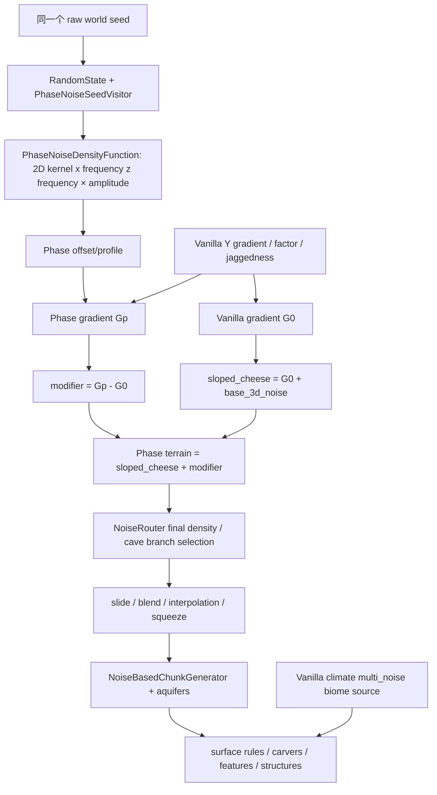

# WPH-016-01：四 Phase 空间地形重设计方案 C

状态：**设计提案 / legacy 实测基准；需要独立 review 后才能开始原型。**
关联：[Issue #34](https://github.com/fangbm/WorldPhase/issues/34)。本 PR 不关闭该 issue。
基线 main：`17f45a590f282f7275031a840c20260ba337539a`，MC 26.1、NeoForge
26.1.0.19-beta、Java 25。生产 Java、维度、density、noise settings 全部保持原样，
冻结 SHA-256 见 [protocol.json](verification/spatial-retune/v1/protocol.json)。

## 1. 决策与证据边界

采用 C：**共享空间骨架 + 各 Phase 自己的地形密度主体 + 可复用的 Vanilla 生态管线**。
不再要求四个世界都以 `overworld/sloped_cheese` 作为主要形态；也不重写 ChunkGenerator。
先做结构验证，再考虑参数。天空/环境单独验收，不能靠色彩滤镜让地形“通过”。

[WPH-015](MVP_PLAYTEST.md) 的结论继续有效：技术回归 PASS，`ROUTE_COMPLETED=0`，
RETUNE，Phase 2 NOT_APPROVED。WPH-013 useful-majority 失败、Hybrid Opening 设计、
SavedData 无可信 preset fingerprint 的限制均未解除。本方案没有实现 Anchor、出生重定向、
教程选择或渲染器。共享地形节点是候选结构，不是已安全、已可玩的路线。

本轮证据分三层：

- **实测**：原生 generator 的 base heights/columns、seeded router density、实际 GPU 客户端图。
- **诊断**：坡度/连通性等有限采样代理；不能证明完整地貌拓扑、碰撞安全或玩家可通过。
- **提案**：下文新数学表达、尺度和验收门槛；尚未生成这些新地形，不能当成结果图。

## 2. 现有生成链：实际做了什么

### 2.1 从 kernel 到地形



`PhaseNoiseDensityFunction` 是薄适配器，叶节点忽略 y。`RandomStateMixin` 在 router
mapAll 的接线阶段通过 visitor 绑定原始世界 seed；四 Phase 不是 seed+index。
`NoiseBasedChunkGenerator` 不变；所有 dimension type 是 `minecraft:overworld`，
biome source 是 `minecraft:multi_noise` / preset `minecraft:overworld`。

关键路径：`src/main/resources/data/worldphase/worldgen/density_function/`、
`worldgen/noise_settings/{smooth,ridge,cell,fracture}.json`、`dimension/*.json`；
`src/main/java/dev/fangbm/worldphase/worldgen/{noise,density,sample}/`。

### 2.2 sloped_cheese 的代数角色，不能仅看 JSON 中的 add

记 `q(n)=quarter_negative(n)`（负值乘 0.25，正值不变），
`Y(y)=y_clamped_gradient(-64,320,1.5,-1.5)`，
`O=overworld/offset`，`F=overworld/factor`，
`J=overworld/jaggedness × half_negative(noise(jagged,1500,0))`，`B=base_3d_noise`。

```text
G0(x,y,z) = 4 q((Y(y) + O(x,z) + J(x,z)) F(x,z))
sloped_cheese = G0 + B(x,y,z)
Gp(x,y,z) = 4 q((Y(y) + Op(x,z) + jp J(x,z)) F(x,z))
modifier = Gp - G0
Tp = sloped_cheese + modifier = Gp + B  (浮点舍入范围内)
```

因此“Vanilla 高度原封不动压过一个小噪声”不是准确解释。旧梯度被减去，Phase 梯度被加回；
真正共享的是 **factor、残留 offset / jaggedness、Vanilla 3D base noise、洞穴、气候、表面和生态语法**。
本轮独立接线采样 G0/Gp/B/Tp，检查这个等式，而非从函数名称推断贡献百分比。
Smooth 的 Gp 在 smooth_terrain.json 内联；其他三个使用独立 *_gradient。
四个Op的准确公共形式是 `Op=-0.55+rp*(O+0.55)+profilep`；表中保留比例rp
作用于以−0.55为基准的起伏，而不是把整个offset直接乘rp。

| Phase | 当前 2D 信号与 profile | 原 Vanilla offset 起伏保留 | jaggedness 比例 |
|---|---|---:|---:|
| Smooth | gradient，f=0.001，amplitude=0.10 | 0.35 | 0.35 |
| Ridge | ridged，f=0.002，2 octaves；2.4(r−0.82) | 0.50 | 0.60 |
| Cell | Worley F1，f=0.003；t=clamp(2(F1−0.18),0,1)，−0.16+0.95t³ | 0.20 | 0.15 |
| Fracture | 2D domain warp，f=0.002，amplitude=1.8，warp f=0.0015 / strength=1400 | 0.35 | 0.20 |

`offset` 是 density 空间的垂直参考，不是 block height。Y 的斜率约 −1/128，
所以 0.1 offset 对应约 12.8 格的简化零交点移动；factor、非线性、B、洞穴和 aquifer
都会改变实际表面，不能用这条换算预测最终高度。`factor` 在不同大陆/侵蚀区缩放密度梯度，
改变穿过零面时对 3D B 的敏感性；不是给高度再乘一个山高系数。
`jaggedness` 留下共享的山地细节，`offset` 保留大陆/谷地相关形态；其空间分布来自 Vanilla
terrain splines / climate routing，不是每个 Phase 自己的形态系统。

### 2.3 final router、洞穴与 surface/biome

当前替换不止 final density 的一个常数项：所有该分支的 sloped_cheese 引用被换成 Tp，
包括 range_choice 的输入及依赖 terrain density 的地下洞穴项。

```text
withEntrances = min(Tp, 5 * caveEntrances)
caveBranch = range_choice(Tp, -1e6, 1.5625, withEntrances, underground(Tp))
final = min(postProcess(slideOverworld(caveBranch)), noodle)
postProcess(d) = squeeze(0.64 * interpolated(blend_density(d)))
```

underground 内的 cheese/layer/spaghetti/pillars 沿用 Vanilla，含
`clamp(1.5 - 0.64*Tp,0,0.5)` 等耦合。`squeeze` 是有界非线性，不能拿 squeeze 后
的 amplitude 当地形高度。preliminary_surface_level 使用匹配的 Phase offset，
关系到 aquifer 的地表参考；barrier/floodedness/spread/lava、ore vein 路由仍是 Vanilla。
Noise settings 的高度 -64..319，水平 cell4、垂直 cell8、海平面63不变。

随后原生 generator 插值、填充 stone/water、执行表面规则，configured carvers、
features/ores、structures 继续走 Vanilla 管线。**有洞穴函数不等于所有最终洞穴来自它**；
carvers 还有独立阶段。locate village 成功也不等于建筑和村民安全，见独立 Issue #25。

气候 continents/erosion/depth/ridges 等槽仍沿 Vanilla，terrain-specific offset 不会自动重写
biome climate。森林、草地、石头、水、同样的海拔水位与相同天空，都会强化 Vanilla 相似感。
山地 biome 可覆盖变平地形；Smooth 海洋变浅仍是已知问题。环境方案不能掩盖这些问题。

### 2.4 为什么算法名字没有带来预期地貌

- **Ridge**：`1-abs(coherent)` 的各向同性脊线不保证方向、长度、相邻山墙或可通行狭谷。
  加 octaves 不会自动得到地质上的连续山脊。
- **Cell**：F1 是离最近点的半径，不是 Voronoi cell ID 或到多边形边界的距离。
  cubic clamp 倾向生成盆心/圆形坡面及饱和区，不能声称已实现蜂窝平台。
- **Fracture**：warp 只扭曲自定义 2D offset 的采样位置，没有将 Vanilla 3D terrain、洞穴或
  气候坐标一并扭曲；连续 warp 也没有明确断层面、岩层落差或裂隙体积。
- **Smooth**：削弱 offset/jaggedness 仍继承共同 B、factor、生态；“比较平”不等于有宽谷连续通道。

可继续 2D 的部分：大陆/共同海岸、谷地/山脊轴线、cell 分区、断层轨迹、台地高度、共享节点。
真正需要 y-dependent density 的部分：悬挑、洞顶/桥、封闭空间、垂直裂隙、错位岩体、体积厚度约束。
这些可以是解析几何的 3D density，不一定需要昂贵的全新 3D 随机噪声。

## 3. 客观基准与复现

冻结 [协议](verification/spatial-retune/v1/PROTOCOL.md) 与
[实测报告](verification/spatial-retune/v1/RESULTS.md)。三个固定 seed：
123456789、8675309、20261011；每 seed 两窗口 forest(-384,896)、highland(1344,1200)，
四 Phase + Overworld control，保留水域与差异不明显的区域，不替换失败/普通样本。

- 同坐标 33×33 / 64格 coarse、17×17 / 16格 fine height/slope maps；海面下仍记录海底实体高度。
- 高度分布、局部3×3起伏、坡度、方向张量、采样连通性、同坐标高度相关及 |Δh|≤4 代理。
- x/y、z/y 原生 base-column 剖面（air/water/lava/solid），并列 raw density planes 与三维体积切片。
- 原生 client30张统一截图：同坐标、y240、yaw135/pitch60、noon6000clear、1280×720、
  FOV70、视距16/sim5、Fancy基础（覆盖后UI为CUSTOM）/cloudsOFF/gamma0.5/particlesMinimal、Vanilla资源。

**不能混淆**：`TerrainSampleService` baseHeight 不含 surface/feature/structures；
`getBaseColumn` 也不是 FULL chunk。直接 finalDensity.compute 通过 marker 叶委托，
不是原生 NoiseChunk 插值结果；27处 native `getInterpolatedNoiseValue` 探针另列差值。
8格的密度剖面会漏掉小洞，不据此证明 topology 或通行。截图才是 FULL 渲染观察。

复现（Java25、已接受 EULA；工具不会擅自接受）：

```sh
./gradlew spatialBaseline
./gradlew spatialBaselineClient  # 原生显示环境，前一步生成的新测试存档
python -m pip install -r tools/spatial-baseline-requirements.txt
./gradlew spatialBaselineReport -PspatialPython=python
# 或 python tools/spatial_baseline.py --plots --require-native --archive
python -m unittest discover -s tools -p test_spatial_baseline.py
./gradlew coreRegressionAll build
```

只在 `run/spatial-baseline-v1/` 建新世界；不改旧 playtest 存档，不在 mod JAR 打包 probe。
数值/图片为有意归档的开发证据，不提交完整世界、运行目录或原始日志。
基准文件的 source hash 是审计锁，不是 SavedData 已验证的 transitive preset fingerprint。

## 4. 新的共同密度契约（提案）

记 p=(x,z)，seed s；所有 H、宽度、长度均为 blocks，D 是无量纲，**D>0 表示实体**。
首个校准 λ=16 blocks/density unit，只是原型起点，不是已选定生产参数。
下文N2/N3约定为有限、归一化到[-1,1]的coherent信号；原生NormalNoise应按实际maxValue
明确缩放/边界，不假设它天然等于[-1,1]。这些定义仅用于新原型，不改变既有kernel输出。

```text
DpCore(x,y,z) = (Hp(x,z) - y)/λ + Ap3 * Np3(x,y,z)
Dterrain = (1-m(p)) Dcommon + m(p) DpCore
Dfinal = nativePostprocess(nativeCaveGrammar(Dterrain))
```

保留 NoiseBasedChunkGenerator、seeded NoiseRouter、aquifers、surface rules、features/ores。
首轮新的 Hp 不依赖 sloped_cheese；保留一份原 legacy 和一个只改系数的控制组，区分结构收益
和简单幅度收益。不得将完整 Vanilla finalDensity 又 add 回来悄悄恢复共同主形态。

`nativeCaveGrammar` 是将当前 Vanilla 洞穴组合中的 terrain 输入参数化后的明确表达，
**不是一个现成可直接调用的公共 API 名称**。需要在后续 PR 对 pinned JSON 逐项展开验证，
尤其1.5625分支阈值、λ、入口、顶底 slide 和 preliminary_surface_level 的一致性。
调 λ 可能改变洞穴开放程度；这是必须测的风险，不是“保留洞穴”四字可以保证。

共同参考面的第一个可执行控制表达是 `Hc=63+64*C(p)+6*N2(p/900)`，
其中 `C=clamp(vanillaContinentalness,-1,1)`；它只复用大陆信号，不复用sloped_cheese。
海岸样条可在结构review后单独冻结替代线性C，不能边测边悄悄换。所有N2/N3以同raw seed
和固定命名channel接线，范围、尺度、salt/NoiseHolder ID写入prototype manifest。

共享图先用512格格点，每cell中心加稳定hash决定的±64格x/z jitter；连接四个轴向邻居，
相邻端点排序后唯一标识边，不用运行时Random。节点/边字段只查询邻近固定cell集合，
边为线段或受控二次曲线；实际邻域覆盖距离必须像Cell一样有界证明/参考oracle。
Smooth从此图按固定edge hash选择连通骨架（保留一条轴向主干，支路可选），谷距离dV是
到这些线段的最小距离；共同节点可用dry mask禁用，但不能因此声称图仍处处连通。
后续prototype必须报告节点密度、dry-mask后连通分量和完整路线，而不是只画美观曲线。

新叶节点必须有 codec/min-max bounds/mapAll/seed-binding 单测。优先现有原生 density
算子和 seeded noise holders；确需解析 cell/fault geometry 才注册最小新 DF 类型。
当前 visitor 只识别 PhaseNoiseDensityFunction，新 morphology 叶不会自动得到 seed；
后续显式扩展 seed-aware binding 契约并测 raw-seed一致性，不能硬编码或seed+phaseIndex。
保持既有 PhaseNoise 2D接口及goldens，不将新3D需求塞进 PhaseDefinition。

### 4.1 Smooth：宽谷和通道，而非普通平原

以共同低频骨架 Hc、确定性的谷地线图 V 为输入，dV 是离谷线最近距离：

```text
Hv = Hc + 4 N2(p/900) - 8 exp(-(dV/64)^2)
Hs = Hv + 3 N2(p/220) * (1-exp(-(dV/64)^2))
Ds = (Hs-y)/16 + 0.04 N3(p/80,y/48)
```

谷地宽48–160、连续长度至少256、间隔256–512，主起伏波长700–1200。
谷线取自下文共享 seed 图的子图，有明确出口，不靠阈值噪声偶然连通。
2D控制宽谷/缓坡/流向；小3D项只做岩体细节，Vanilla洞穴继续独立工作。
海岸 Hc 的过渡独立于谷深，避免把海底抬到同一薄层；首轮检查海洋深度分布。

风险：过平、谷地全被水占据、biome山地违和、细节噪声破坏步行通道。
验收：多条足宽可步行谷段、连续出口、仍有丘陵/水域；与Vanilla平原的盲辨和几何指标分开。

### 4.2 Ridge：有方向的连续山墙与狭谷

θ由稳定 seed channel 选定区域主方向，n为其法向，t为切向；边界用平滑大区插值，
不在每个256格格子突然旋转方向。

```text
u = dot(p,n)/320 + 0.16 N2(p/600)
r = exp(-(sin(pi*u)/0.22)^2)
Hr = Hc + 48 r - 10 (1-r) + 4 N2(dot(p,t)/600, dot(p,n)/900)
Dr = (Hr-y)/16 + 0.12 wallMask(r) N3(p/64,y/40)
```

脊线间隔256–512、半宽24–40、连续长度512+；方向扰动梯度限制，避免主轴折断。
2D负责长轴/狭谷/山高，3D只在山墙做局部台阶与浅悬挑；不把旧各向同性Ridged改名后当新结构。
原型先测平行脊，再测方向缓变，禁止一开始无约束warp。

风险：无限长屏障、所有相邻Phase高差大于4、山壁露出结构、洞穴入口消失。
在共享节点外保留鞍部/缺口，比较沿脊与跨脊路径，不把高std等同好山脊。

### 4.3 Cell：多边形盆地、台阶边界和平台

新增几何信号 nearest-site ID、最近site q0、真正边界距离 e；**不修改现有Worley F1**。

```text
e(p) = min_i>0 (|p-qi|² - |p-q0|²) / (2 |qi-q0|)
b = 1 - smoothstep(8,32,e)
terrace(b) = round(3*b)/3，阶跃边缘用2–4格连续bevel
Hcell = Hc + cellBias(ID)*6 + 18 terrace(b) - 6(1-b)
Dsurface = (Hcell-y)/16 + 0.03 N3(p/100,y/60)
E = |p-q0|²/45² + (y-(Hc(q0)-24))²/10² - 1
Dcell = min(Dsurface,E)  # 仅选中的dry cell开启地下腔；E<0内部为空
```

cell直径160–320、平台边界台阶6–18格、盆心宽60–160；保持cell相位稳定/ID边界不抖动。
不要求规则六边形：jittered Voronoi是多边形，不等于蜂窝六边形。若要规则蜂窝另作对照。
2D给拓扑/平台/边界；3D E给实质可进入封闭空间，屋顶/地板最低厚度独立检查，
首轮可禁腔体比较纯平台，避免一次叠加过多机制。

邻居搜索必须证明覆盖最近点和可能限制边界的site，不能照抄F1的3×3假设。
以固定7×7参考或保守界限实现oracle，对高效有限邻域结果做边界/负坐标/等距单测；
最终成本硬上限随证明确定，不构建巨型点表。不能以F2-F1无说明地冒充精确欧氏边界距离。

风险：台地饱和导致平板世界、边缘过陡无出口、腔体浸水、cell边界不连续/计算昂贵。
实测平台面积、边界长度、独立单元与门户，不仅看“圆坑很多”。

### 4.4 Fracture：断层与裂隙体积

确定性fault graph给带方向的signed distance f(p)、沿线坐标l、有限端点遮罩a(l)。
断层throw τ=16–48、过渡w=2–8、裂隙宽8–24、trace长度256–768。

```text
throw(p) = a(l) * τ/2 * tanh(f/w)
Q = (x+wx(p), y-throw(p), z+wz(p))
Tf = (Hf(Q.x,Q.z)-Q.y)/16 + 0.12 N3(Q/64)
Rift = max(abs(f)/riftWidth-1, (y-riftTop)/8, (riftBottom-y)/8, endCap(l))
Df = min(Tf,Rift)   # Rift<0的有限垂直裂隙为空
```

wx/wz为独立稳定channel、幅度64–192、尺度384–768；这次明确扭曲的是自有岩体几何和3Ddetail，
不是只warp一个offset叶。fault两侧位移、裂隙开口和不规则coherent hills做ablation对照。
endCap(l)在有限trace范围内≤0、端点外>0，显式封闭裂隙端部。
2D定义断层trace/落差和水平变形；3D定义裂谷深度、错层体积和悬挑，必须观察垂直剖面。

不随意包装任意Vanilla DF的FunctionContext来全局warp：cache/interpolated markers的上下文
语义可能失效。原型用明确解析表达和NoiseHolder；Vanilla气候/地下洞穴/aquifer坐标暂不warp。
首轮仅dry、sea+8以上开裂隙或明确限制至地下水以上，再做湿裂隙专项；不能声称aquifer自动正确。

风险：致命跌落、裂隙处柱状接缝、所有出口失配、异常水墙、过多3D采样。安全共同节点屏蔽
fault throw/裂隙，不把整个世界视觉“不规则”当空间warp成功。

## 5. 共享空间结构与正常 ±4 的关系

共享 raw seed 并不意味着四个 Hp 接近；独立重设计会进一步降低随机位置的可切换率。
选择**稀疏共同节点 + 相邻Phase不同障碍的路径图**，不选择到处等高，也不改变TransferPolicy。

1. 同seed生成粗图（节点256–512格尺度），每节点8格内共享Hc和完整近表面实体，
   8..24格smoothstep过渡；节点只在共同dry参考Hc≥sea+8时启用。
2. 节点内m=0，外m=1；禁止近表面主洞穴/裂隙破坏共同地板，保留地下洞穴。
   Hc同一表达，同一y/固体厚度，避免“高度相近但脚下空”的伪保证。
3. 图边不是四Phase相同的安全高速路。A中某边受山墙阻挡，B中同边是谷道，
   共享入口/出口节点提供切换位置；以实际路线entry→walk→exit验证收益。
4. 初始节点占地预算5–15%，分别测8/16/24格半径与256/512间距，避免共同区吞没Phase辨识度。
5. 共同密度不控制树、结构、实体、玩家改造或未来液体变化；最终仍由LandingSafety与
   SafeLandingResolver使用真实AABB/支撑/危险判断。静态相同地板不是永久安全承诺。

`|baseHeightA-baseHeightB|≤4`只做筛选代理；不得自动算SHIFT_POSITION_FEASIBLE。
没有真实安全节点或回程出口的路线归失败，不用DEV_SURFACE补救。
受控Anchor Station仍由Hybrid Opening的未来独立设计负责，本轮不放置任何结构/方块。

## 6. Vanilla 保留边界与风险控制

| 子系统 | 原型边界 | 必测项 |
|---|---|---|
| Biome climate | 首轮维持Vanilla multi_noise与climate槽，控制变量 | 同坐标biome、山地/平原错配；depth改路由另开实验 |
| Caves | 地形输入改为Dterrain，保留Vanilla grammar，记录分支 | 表层开洞、洞顶厚度、入口、noodle、carver阶段 |
| Aquifers | 保留native实现与seed，重做匹配的surface estimate | 海岸/裂隙水墙、浅海、封闭腔水、lava |
| Surface/ores/features | 复用原管线 | grass/dirt/stone、雪线、矿脉、树穿透/悬空 |
| Structures/entities | 不承诺旧布置安全，保留风险追踪 | 实际村庄/村民，不能只locate；#25不在此修复 |
| Blend/interpolation | 原生wrapper仅在正确接线阶段使用 | raw/interpolated/FULL差异、边界、min-max bounds |
| Server/client | 世界生成公共逻辑无client依赖 | dedicated cold/reload、classloading、无渲染器JAR泄漏 |

## 7. 分阶段独立 PR 与停止条件

| PR阶段 | 实施范围 | 交付与继续条件 |
|---|---|---|
| 1 本轮 | unchanged基准、源码归因、设计和环境API审计 | 三seed完整数据与原生图；review数学/风险；本轮不写生产原型 |
| 2 Smooth/Ridge | 最小新地貌算子+隔离v2原型，legacy/系数控制组并列 | 新存档，neutral-sky地形门槛、谷/脊结构、seed/codec/性能通过 |
| 3 Cell/Fracture | 真边界/断层解析密度，分步开3D腔/裂隙 | 新存档，负坐标邻域oracle、剖面/水体/实体安全和辨识度通过 |
| 4 环境 | 数据属性优先，必要时独立client sky/cloud renderer | [环境方案](PHASE_ENVIRONMENT_ART_DIRECTION.md)，低配关闭路径/无闪烁/服务器安全；不抵消地形FAIL |
| 5 路线与性能 | 冻结路线、holdout、真实生存/重复Shift、结构风险 | 分别报告terrain/environment/gameplay；可RETUNE/STOP，不靠自动测试宣布GO |

每一步最多两轮预注册结构/尺度试验，之后review原因再继续，避免无限调参。
若共同节点使地貌失真、±4仍不能支撑有效路线、性能超预算，暂停扩展，比较减少Phase、
受控路径/Hybrid Opening等设计选项；不偷偷放宽正常传送。

## 8. 存档、区块接缝与版本管理

**每个实验arm新建存档**，分别标注seed、variant、版本和preset依赖；禁止复用旧世界覆盖设置。
开发基准不会删旧存档；缺数据/摄像机遮挡/失败均非零退出并保留记录。

后续新增不可变settings IDs（示例`worldphase:prototype_v2/ridge`，不是本轮已注册内容），
测试dimension映射独立受控：仅新实验存档的隔离datapack把现有四dimension keys指向版本化settings，
不新增业务PhaseId、不修改PhaseDefinition，保留legacy v1资源。生产升级需明确兼容策略，不能更新相同ID
就认定世界迁移成功：已有chunk保持旧方块，未生成chunk使用新密度，形成山墙、水墙、洞穴断口、
结构截断；Vanilla blending不能自动保证任意自定义density连续。只重置一个Phase会破坏共同图。

升级建议：备份旧存档→新独立世界验收→用户显式选择新世界；若未来做迁移工具，另开设计。
不自动替换SavedData选择，不把searched当selected。

可靠provenance应涵盖递归解析后的settings/DF/noise/biome/surface/structure依赖、实际datapack
优先级及内容、mod与toolchain、seed、schema和算子版本；规范化后生成摘要并记录无法覆盖项。
本轮文件SHA仅锁定本仓库基准输入，**不解锁SavedData自然候选验证**。旧证据在seed、配置、
评分/生成版本、preset或依赖变化时重新验证，shift-feasible也不等于route-validated。

## 9. 预先冻结的独立验收标准（后续原型）

### 技术与地形

- 既有goldens、同seed确定性、registry/codec、cold/save/reload、dedicated、真实碰撞测试继续通过。
- 同本轮三seed/两窗口完整采样，加预留holdouts：606102026、-77331057、424242424242。
  新原型不得先看holdouts再改参数；失败样本不可换seed/镜头。
- 地形盲辨：neutral sky、相同材质/时间/相机、去除Phase UI，四类标注准确率目标总体≥80%、
  每Phase≥70%；至少两名独立评审，记录n、混淆矩阵及样本，不声称本轮已做。
- Ridge：每seed至少两条≥256格连续脊，几何长宽比≥4，有谷/鞍部；方向张量只是辅助。
- Cell：每seed至少三完整相邻多边形单元，平台/边界可辨且有入口，不以圆形F1图替代。
- Fracture：每seed至少两可追踪≥256格断层/裂隙，有可测落差和3D剖面；禁warp对照证实因果。
- Smooth：每seed至少两条宽≥32、长≥256的连续缓谷段，有出口；保留丘陵/水体，非整图平板。
- 这些几何指标使用≤8格格网+实际FULL观察确认，不能直接用本轮64格基准宣称通过。

### 环境（独立）

天空/云/音效不依靠地形标签可辨；特效关闭仍清晰可玩；不增加危险遮蔽，不改变mob/bed日夜逻辑。
高/低配分档、灰度/色觉/光敏检查、frame-time与服务器类加载通过。详细门槛见环境文档。

### Phase Shift 玩法（独立）

预注册18条自然/共享图路线：3seed × 3pair(F↔S,R↔S,C↔F) × 2条，明确起点、目标、
source对照、移动预算、entry/exit成功条件；原型路线冻结后再跑，不以失败后放宽坐标补成功。
目标至少6个独立ROUTE_COMPLETED、每seed≥2、每pair≥1，holdout至少2seed有实际成功案例。
路线必须正常±4同double x/z切入，Survival行走并合法切出/抵达目标，保留身份/背包；
DEV_SURFACE和飞行仅可用于标注过的bootstrap，不计途中成功。真实玩家主观反馈另列；
脚本失败不证明人类绝对不可走，脚本图也不伪称human-playtested。

无论图多美、200/400次传送多稳定，都不能绕过路线门槛宣布GO；失败可形成有效RETUNE或STOP结论。

### 性能

按CPU时间/每chunk、分阶段worldgen、MSPT p50/p95/max、native frame p50/p95、heap/GC记录，
冷热缓存分开，硬件/视距固定，至少三轮顺序交错control/prototype。相对legacy生成CPU p95
目标≤1.5×、steady server MSPT p95≤50ms、无持续heap增长；超预算先归因再决定，不改数学掩盖结果。
这是假设性原型预算，不作为机器相关单元测试assert。单kernel倍率不等于完整chunk倍率。

## 10. 源码与官方依据

本轮直接检查生成源码 `build/moddev/artifacts/minecraft-patched-26.1.0.19-beta-sources.jar`：
`NoiseRouterData`、`NoiseBasedChunkGenerator`、`RandomState`、`NoiseChunk`、`DimensionType`，
以及jar内Vanilla overworld density/noise_settings/biome/dimension_type JSON。
本地生成物不提交；版本与API摘录由文档及基准报告保留。

环境API参考与精确26.1签名见[环境设计](PHASE_ENVIRONMENT_ART_DIRECTION.md)。
[NeoForge 26.1 migration notes](https://docs.neoforged.net/primer/docs/26.1/)
和[pinned NeoForge sources](https://maven.neoforged.net/releases/net/neoforged/neoforge/26.1.0.19-beta/neoforge-26.1.0.19-beta-sources.jar)
是辅助依据；与泛用旧教程冲突时，以本仓库实际patched源码/资源为准。
