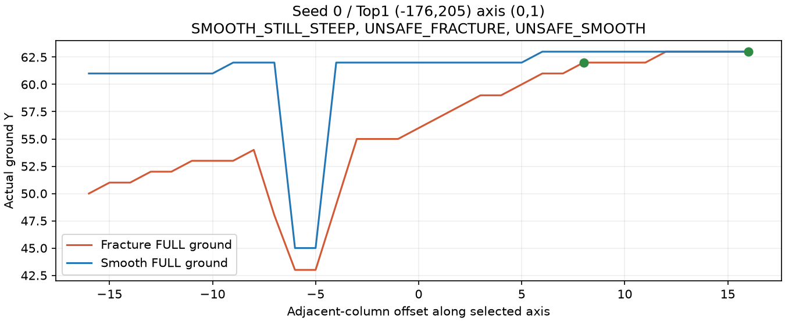
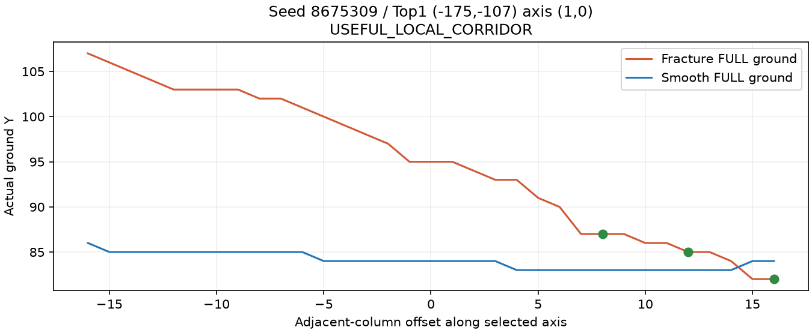
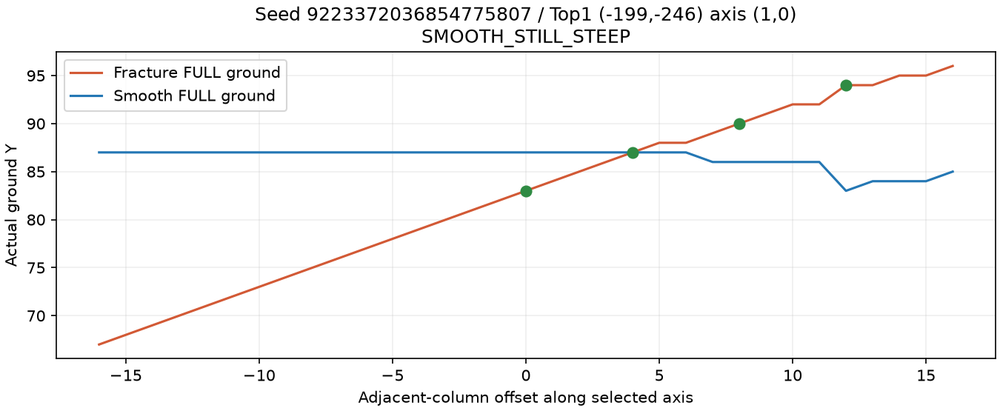
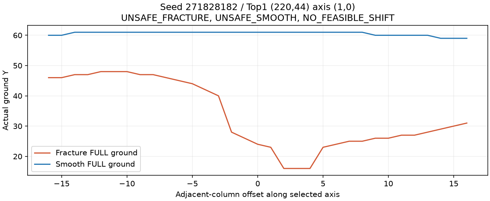

# Frozen v4 review experiment: actual results

Final validation: focused tutorial/command/real-preset sampling tests **126/126**;
`./gradlew coreRegressionAll build --console=plain --no-build-cache` **PASS**,
345 tests (330 transforming-loader,15 plain dev-tooling), zero failures/errors.
Cold/reload dedicated probes each completed50 full cycles:400 loop transfers,
456 total successful transfers,495 inventory identity/content checks; exact x/z
and yaw/pitch maximum deviation0,duplicate entities/items0. FULL terrain/marker
and native player data restored before fixture reset. The production JAR excludes
verification/test/profiling classes; protected kernels/goldens/presets/domain/
TransferPolicy are unchanged. No GUI/login evidence is claimed by this headless
run; it uses actual ServerPlayer/native teleport with discarded outbound packets.

Attribution ten-server run exited0 in7m11s. Final refined fifteen-server run plus
focused tests exited0 in13m23s; coreRegressionAll/build exited0 in2m33s. Logs and
machine reports remain ignored. Isolated FULL auditing/initial generation can
produce Can't keep up warnings; Windows PerfOS, Vanilla command ambiguities and
one external Yggdrasil TLS-key-fetch error were observed. No wp ambiguity,
invariant, density/registry/Mixin error occurred. Quality shortfall remains explicit.

The unchanged [original protocol](TUTORIAL_SEARCH_VALIDATION.md) remains **2/10 Top1**.
[Failure attribution](TUTORIAL_SEARCH_ATTRIBUTION.md) was completed before the
[v4 plan](TUTORIAL_SEARCH_REFINEMENT_PLAN.md) was frozen and implemented. No seeds,
weights or safety thresholds were changed after seeing v4 results. Timing-only CPU
instrumentation was then added and the full15 fresh-server experiment repeated.
Base candidate/ranking evidence stayed identical; real-time safety snapshots can
differ between fresh runs even when observed ground heights are unchanged.
Neither protocol certifies
a continuous playable path; v4 additionally requires a real bidirectional +/-4 landing.

**Original10: new Top1 1/10; Top3-any 1/10;
bounded-shift Top1 8/10; Top3-any 9/10.**
Holdout5: Top1 0/5; Top3-any 0/5;
bounded-shift Top1 3/5; Top3-any 3/5.
Quality status: **QUALITY_SHORTFALL**; useful-majority met: **False**.
Keep PR30 Draft. Top3 is a new metric, never a replacement for old Top1.

## Every seed

| Group / seed | Center | Top1 / Top3 useful | Top1 / Top3 shift | Top1 F/S adjacent step | Unsafe F/S columns | Top1 causes |
| --- | --- | --- | --- | --- | --- | --- |
| original 0 | -32,0 | 0/0 | 1/1 | 6/17 | 27/14 | SMOOTH_STILL_STEEP, UNSAFE_FRACTURE, UNSAFE_SMOOTH |
| original 1 | 160,160 | 0/0 | 0/0 | 6/1 | 3/30 | UNSAFE_FRACTURE, UNSAFE_SMOOTH, NO_FEASIBLE_SHIFT |
| original -1 | 496,384 | 0/0 | 1/1 | 3/1 | 13/10 | UNSAFE_FRACTURE, UNSAFE_SMOOTH |
| original 42 | -32,0 | 0/0 | 0/1 | 2/1 | 0/33 | UNSAFE_SMOOTH, NO_FEASIBLE_SHIFT |
| original 8675309 | 16,80 | 1/1 | 1/1 | 3/1 | 0/0 | USEFUL_LOCAL_CORRIDOR |
| original 20261009 | 0,0 | 0/0 | 1/1 | 2/1 | 13/5 | UNSAFE_FRACTURE, UNSAFE_SMOOTH |
| original 123456789 | 64,-48 | 0/0 | 1/1 | 1/1 | 11/0 | NO_FRACTURE_STEP, UNSAFE_FRACTURE |
| original 987654321 | 0,0 | 0/0 | 1/1 | 2/4 | 6/5 | SMOOTH_STILL_STEEP, UNSAFE_FRACTURE, UNSAFE_SMOOTH |
| original -7046029254386353131 | 0,0 | 0/0 | 1/1 | 2/5 | 18/22 | SMOOTH_STILL_STEEP, UNSAFE_FRACTURE, UNSAFE_SMOOTH |
| original 9223372036854775807 | 0,0 | 0/0 | 1/1 | 2/3 | 0/0 | SMOOTH_STILL_STEEP |
| holdout 314159265 | 0,32 | 0/0 | 1/1 | 2/1 | 6/0 | UNSAFE_FRACTURE |
| holdout 271828182 | 25,95 | 0/0 | 0/0 | 12/1 | 33/33 | UNSAFE_FRACTURE, UNSAFE_SMOOTH, NO_FEASIBLE_SHIFT |
| holdout 20260711 | 0,0 | 0/0 | 1/1 | 2/1 | 28/23 | UNSAFE_FRACTURE, UNSAFE_SMOOTH |
| holdout -20260930 | -512,-96 | 0/0 | 0/0 | 9/1 | 4/4 | UNSAFE_FRACTURE, UNSAFE_SMOOTH, NO_FEASIBLE_SHIFT |
| holdout -9223372036854775808 | 0,0 | 0/0 | 1/1 | 3/1 | 3/6 | UNSAFE_FRACTURE, UNSAFE_SMOOTH |

## Performance and average quality

CPU is ThreadMXBean current-server-thread CPU over sampling/stage work. computeMs
is elapsed time inside that work (includes descheduling/GC); wall includes tick waits.
Missing CPU support prints -1, never a fabricated estimate. FULL validation and
independent generator cross-checks are excluded from search timing. The initial
measurement has normal JIT/first-use cost. Time is descriptive, not a CI assertion.

Windows CPU counters have coarse resolution; summing short batch deltas can show
quantization error, including CPU slightly above active elapsed for one run.

| Seed | Heights | Ticks | CPU ms | Active elapsed ms | Wall ms | Max2-column batch ms | FULL validation requests |
| --- | ---: | ---: | ---: | ---: | ---: | ---: | ---: |
| 0 | 768 | 384 | 2890.6 | 3434.0 | 19166.2 | 15.5 | 66 |
| 1 | 768 | 384 | 3000.0 | 3424.5 | 19165.7 | 17.7 | 80 |
| -1 | 768 | 384 | 3265.6 | 3640.1 | 19163.6 | 17.2 | 66 |
| 42 | 768 | 384 | 3578.1 | 3407.8 | 19165.1 | 16.0 | 60 |
| 8675309 | 768 | 384 | 3343.8 | 3526.3 | 19168.8 | 17.4 | 66 |
| 20261009 | 768 | 384 | 3453.1 | 3506.8 | 19165.1 | 20.9 | 60 |
| 123456789 | 768 | 384 | 3593.8 | 3554.2 | 19162.7 | 17.1 | 66 |
| 987654321 | 766 | 383 | 2718.8 | 2958.4 | 19112.6 | 16.1 | 60 |
| -7046029254386353131 | 768 | 384 | 2687.5 | 2887.3 | 19162.2 | 14.9 | 68 |
| 9223372036854775807 | 768 | 384 | 2625.0 | 2943.4 | 19161.5 | 14.2 | 68 |
| 314159265 | 768 | 384 | 2562.5 | 2970.5 | 19162.6 | 11.2 | 66 |
| 271828182 | 768 | 384 | 2968.8 | 2926.5 | 19162.7 | 13.5 | 60 |
| 20260711 | 768 | 384 | 3000.0 | 2929.7 | 19162.6 | 12.9 | 66 |
| -20260930 | 768 | 384 | 2562.5 | 2889.4 | 19163.8 | 20.3 | 66 |
| -9223372036854775808 | 768 | 384 | 4093.8 | 4149.3 | 19168.0 | 22.2 | 66 |

original10 mean metrics: `{"computeMs": 3328.28, "cpuMs": 3115.62, "heightSamples": 767.8, "maxBatchMs": 16.7, "ticks": 383.9, "wallMs": 19159.36}`.
All audited Top3 candidate quality: 1/30;
mean actual F/S maximum adjacent step: 2.67/2.60;
mean unsafe standing columns F/S: 14.17/14.07.
Overlapping failure counts: `{"NO_FEASIBLE_SHIFT": 12, "NO_FRACTURE_STEP": 7, "SMOOTH_STILL_STEEP": 7, "UNSAFE_FRACTURE": 25, "UNSAFE_SMOOTH": 25, "USEFUL_LOCAL_CORRIDOR": 1}`.

holdout5 mean metrics: `{"computeMs": 3173.09, "cpuMs": 3037.5, "heightSamples": 768, "maxBatchMs": 16.03, "ticks": 384, "wallMs": 19163.91}`.
All audited Top3 candidate quality: 0/15;
mean actual F/S maximum adjacent step: 4.20/1.73;
mean unsafe standing columns F/S: 15.60/13.53.
Overlapping failure counts: `{"NO_FEASIBLE_SHIFT": 10, "NO_FRACTURE_STEP": 2, "SMOOTH_STILL_STEEP": 2, "UNSAFE_FRACTURE": 12, "UNSAFE_SMOOTH": 11}`.

## Base versus FULL limits

| Seed | Top3 center-height mismatches | Directionally interesting but actual rejected |
| --- | ---: | ---: |
| 0 | 0 | 3 |
| 1 | 0 | 3 |
| -1 | 0 | 3 |
| 42 | 0 | 3 |
| 8675309 | 0 | 2 |
| 20261009 | 0 | 3 |
| 123456789 | 0 | 3 |
| 987654321 | 0 | 3 |
| -7046029254386353131 | 0 | 3 |
| 9223372036854775807 | 0 | 3 |
| 314159265 | 0 | 3 |
| 271828182 | 0 | 3 |
| 20260711 | 1 | 3 |
| -20260930 | 0 | 3 |
| -9223372036854775808 | 0 | 3 |

The directionally interesting label is deliberately UNVERIFIED, not a base
acceptance PASS. Four-block base slopes can miss single-block FULL cuts and
body hazards even when center heights agree. The actual data below reports
these rejections without changing TerrainSampleService semantics.

## Top3 detail and bounded-shift evidence

All Top5 signals are preserved in ignored per-seed refined-report.json. Below are
the actual Top3: no lower rank is substituted into the Top1 result. Risk is a base
hint; unsafe counts use real FULL terrain and unchanged LandingSafety. Source feet
use natural ground+1, which can conservatively reject fractional support shapes.

### Seed 0

| Rank x,z | Axis | Base F/S step | Base contrast | Risk / rank score | Actual F/S step | Unsafe F/S | Shift proofs | Causes |
| --- | --- | --- | --- | --- | --- | --- | --- | --- |
| #1 -176,205 | 0,1 | 0.750/0.250 | 11.0 | REQUIRES_VALIDATION / +24.19 | 6/17 | 27/14 | 2 | SMOOTH_STILL_STEEP, UNSAFE_FRACTURE, UNSAFE_SMOOTH |
| #2 -47,-227 | 1,1 | 0.530/0.177 | 9.0 | LOW_RISK / +22.98 | 1/1 | 0/8 | 7 | NO_FRACTURE_STEP, UNSAFE_SMOOTH |
| #3 -25,156 | 0,1 | 0.500/0.250 | 7.0 | REQUIRES_VALIDATION / +9.65 | 1/1 | 10/11 | 4 | NO_FRACTURE_STEP, UNSAFE_FRACTURE, UNSAFE_SMOOTH |
Actual shift attempts Top1: sourceUnsafe=7, forwardRejected=0, reverseRejected=0.
Example actual source -> destination -> reverse: `{"destination": {"x": -175.5, "y": 64.0, "z": 213.5}, "reverse": {"x": -175.5, "y": 63.0, "z": 213.5}, "source": {"x": -175.5, "y": 63.0, "z": 213.5}}`.

This is a plot of real server-generated terrain data, not a client screenshot or continuous path proof.

### Seed 1

| Rank x,z | Axis | Base F/S step | Base contrast | Risk / rank score | Actual F/S step | Unsafe F/S | Shift proofs | Causes |
| --- | --- | --- | --- | --- | --- | --- | --- | --- |
| #1 415,176 | 1,0 | 2.250/0.250 | 16.0 | REQUIRES_VALIDATION / +118.35 | 6/1 | 3/30 | 0 | UNSAFE_FRACTURE, UNSAFE_SMOOTH, NO_FEASIBLE_SHIFT |
| #2 60,-1 | 0,1 | 1.250/0.250 | 11.0 | REQUIRES_VALIDATION / +57.62 | 4/1 | 28/33 | 0 | UNSAFE_FRACTURE, UNSAFE_SMOOTH, NO_FEASIBLE_SHIFT |
| #3 365,32 | 0,1 | 0.750/0.250 | 16.0 | REQUIRES_VALIDATION / +25.34 | 1/1 | 33/33 | 0 | NO_FRACTURE_STEP, UNSAFE_FRACTURE, UNSAFE_SMOOTH, NO_FEASIBLE_SHIFT |
Actual shift attempts Top1: sourceUnsafe=2, forwardRejected=7, reverseRejected=0.

### Seed -1

| Rank x,z | Axis | Base F/S step | Base contrast | Risk / rank score | Actual F/S step | Unsafe F/S | Shift proofs | Causes |
| --- | --- | --- | --- | --- | --- | --- | --- | --- |
| #1 798,436 | 1,1 | 1.061/0.177 | 16.0 | REQUIRES_VALIDATION / +47.05 | 3/1 | 13/10 | 1 | UNSAFE_FRACTURE, UNSAFE_SMOOTH |
| #2 480,599 | 1,1 | 0.884/0.177 | 21.0 | REQUIRES_VALIDATION / +38.81 | 2/1 | 4/4 | 2 | UNSAFE_FRACTURE, UNSAFE_SMOOTH |
| #3 388,710 | 1,1 | 0.707/0.177 | 9.0 | REQUIRES_VALIDATION / +23.58 | 2/1 | 29/33 | 0 | UNSAFE_FRACTURE, UNSAFE_SMOOTH, NO_FEASIBLE_SHIFT |
Actual shift attempts Top1: sourceUnsafe=4, forwardRejected=4, reverseRejected=0.
Example actual source -> destination -> reverse: `{"destination": {"x": 798.5, "y": 63.0, "z": 436.5}, "reverse": {"x": 798.5, "y": 64.0, "z": 436.5}, "source": {"x": 798.5, "y": 64.0, "z": 436.5}}`.

### Seed 42

| Rank x,z | Axis | Base F/S step | Base contrast | Risk / rank score | Actual F/S step | Unsafe F/S | Shift proofs | Causes |
| --- | --- | --- | --- | --- | --- | --- | --- | --- |
| #1 -364,-128 | 0,1 | 1.250/0.250 | 38.0 | REQUIRES_VALIDATION / +53.66 | 2/1 | 0/33 | 0 | UNSAFE_SMOOTH, NO_FEASIBLE_SHIFT |
| #2 -14,-147 | 0,1 | 1.000/0.250 | 82.0 | REQUIRES_VALIDATION / +42.53 | 7/22 | 6/32 | 0 | SMOOTH_STILL_STEEP, UNSAFE_FRACTURE, UNSAFE_SMOOTH, NO_FEASIBLE_SHIFT |
| #3 40,-245 | 0,1 | 1.000/0.250 | 32.0 | REQUIRES_VALIDATION / +40.01 | 1/1 | 2/1 | 1 | NO_FRACTURE_STEP, UNSAFE_FRACTURE, UNSAFE_SMOOTH |
Actual shift attempts Top1: sourceUnsafe=0, forwardRejected=9, reverseRejected=0.

### Seed 8675309

| Rank x,z | Axis | Base F/S step | Base contrast | Risk / rank score | Actual F/S step | Unsafe F/S | Shift proofs | Causes |
| --- | --- | --- | --- | --- | --- | --- | --- | --- |
| #1 -175,-107 | 1,0 | 1.500/0.250 | 21.0 | LOW_RISK / +81.67 | 3/1 | 0/0 | 3 | USEFUL_LOCAL_CORRIDOR |
| #2 -58,214 | 1,0 | 1.250/0.250 | 22.0 | REQUIRES_VALIDATION / +60.54 | 2/1 | 10/3 | 3 | UNSAFE_FRACTURE, UNSAFE_SMOOTH |
| #3 7,-1 | 1,1 | 0.884/0.177 | 14.0 | REQUIRES_VALIDATION / +41.97 | 6/1 | 22/33 | 0 | UNSAFE_FRACTURE, UNSAFE_SMOOTH, NO_FEASIBLE_SHIFT |
Actual shift attempts Top1: sourceUnsafe=0, forwardRejected=6, reverseRejected=0.
Example actual source -> destination -> reverse: `{"destination": {"x": -166.5, "y": 84.0, "z": -106.5}, "reverse": {"x": -166.5, "y": 88.0, "z": -106.5}, "source": {"x": -166.5, "y": 88.0, "z": -106.5}}`.

This is a plot of real server-generated terrain data, not a client screenshot or continuous path proof.

### Seed 20261009

| Rank x,z | Axis | Base F/S step | Base contrast | Risk / rank score | Actual F/S step | Unsafe F/S | Shift proofs | Causes |
| --- | --- | --- | --- | --- | --- | --- | --- | --- |
| #1 -52,-26 | 0,1 | 1.500/0.250 | 22.0 | REQUIRES_VALIDATION / +77.43 | 2/1 | 13/5 | 2 | UNSAFE_FRACTURE, UNSAFE_SMOOTH |
| #2 99,-133 | 0,1 | 1.500/0.250 | 21.0 | REQUIRES_VALIDATION / +76.05 | 2/1 | 16/4 | 3 | UNSAFE_FRACTURE, UNSAFE_SMOOTH |
| #3 -157,129 | 1,0 | 1.000/0.250 | 15.0 | REQUIRES_VALIDATION / +42.05 | 2/1 | 11/33 | 0 | UNSAFE_FRACTURE, UNSAFE_SMOOTH, NO_FEASIBLE_SHIFT |
Actual shift attempts Top1: sourceUnsafe=4, forwardRejected=3, reverseRejected=0.
Example actual source -> destination -> reverse: `{"destination": {"x": -51.5, "y": 68.0, "z": -25.5}, "reverse": {"x": -51.5, "y": 70.0, "z": -25.5}, "source": {"x": -51.5, "y": 70.0, "z": -25.5}}`.

### Seed 123456789

| Rank x,z | Axis | Base F/S step | Base contrast | Risk / rank score | Actual F/S step | Unsafe F/S | Shift proofs | Causes |
| --- | --- | --- | --- | --- | --- | --- | --- | --- |
| #1 -241,-168 | 1,0 | 1.000/0.250 | 5.0 | REQUIRES_VALIDATION / +37.26 | 1/1 | 11/0 | 6 | NO_FRACTURE_STEP, UNSAFE_FRACTURE |
| #2 -28,177 | 1,0 | 0.750/0.250 | 7.0 | LOW_RISK / +31.62 | 4/2 | 0/0 | 4 | SMOOTH_STILL_STEEP |
| #3 264,-105 | 1,0 | 0.500/0.000 | 7.0 | REQUIRES_VALIDATION / +24.44 | 3/2 | 33/33 | 0 | SMOOTH_STILL_STEEP, UNSAFE_FRACTURE, UNSAFE_SMOOTH, NO_FEASIBLE_SHIFT |
Actual shift attempts Top1: sourceUnsafe=3, forwardRejected=0, reverseRejected=0.
Example actual source -> destination -> reverse: `{"destination": {"x": -256.5, "y": 66.0, "z": -167.5}, "reverse": {"x": -256.5, "y": 70.0, "z": -167.5}, "source": {"x": -256.5, "y": 70.0, "z": -167.5}}`.

### Seed 987654321

| Rank x,z | Axis | Base F/S step | Base contrast | Risk / rank score | Actual F/S step | Unsafe F/S | Shift proofs | Causes |
| --- | --- | --- | --- | --- | --- | --- | --- | --- |
| #1 -140,46 | 0,1 | 1.250/0.250 | 24.0 | REQUIRES_VALIDATION / +57.05 | 2/4 | 6/5 | 1 | SMOOTH_STILL_STEEP, UNSAFE_FRACTURE, UNSAFE_SMOOTH |
| #2 -260,-105 | 1,0 | 1.250/0.250 | 69.0 | REQUIRES_VALIDATION / +55.43 | 4/1 | 33/7 | 0 | UNSAFE_FRACTURE, UNSAFE_SMOOTH, NO_FEASIBLE_SHIFT |
| #3 210,-196 | 1,0 | 1.250/0.250 | 78.0 | REQUIRES_VALIDATION / +55.27 | 3/1 | 33/11 | 0 | UNSAFE_FRACTURE, UNSAFE_SMOOTH, NO_FEASIBLE_SHIFT |
Actual shift attempts Top1: sourceUnsafe=1, forwardRejected=7, reverseRejected=0.
Example actual source -> destination -> reverse: `{"destination": {"x": -139.5, "y": 68.0, "z": 30.5}, "reverse": {"x": -139.5, "y": 72.0, "z": 30.5}, "source": {"x": -139.5, "y": 72.0, "z": 30.5}}`.

### Seed -7046029254386353131

| Rank x,z | Axis | Base F/S step | Base contrast | Risk / rank score | Actual F/S step | Unsafe F/S | Shift proofs | Causes |
| --- | --- | --- | --- | --- | --- | --- | --- | --- |
| #1 -279,203 | 0,1 | 1.250/0.250 | 9.0 | REQUIRES_VALIDATION / +53.60 | 2/5 | 18/22 | 1 | SMOOTH_STILL_STEEP, UNSAFE_FRACTURE, UNSAFE_SMOOTH |
| #2 -40,69 | 1,1 | 0.707/0.177 | 16.0 | REQUIRES_VALIDATION / +31.07 | 2/1 | 33/15 | 0 | UNSAFE_FRACTURE, UNSAFE_SMOOTH, NO_FEASIBLE_SHIFT |
| #3 -47,209 | 1,0 | 0.750/0.250 | 5.0 | REQUIRES_VALIDATION / +23.92 | 1/1 | 12/2 | 6 | NO_FRACTURE_STEP, UNSAFE_FRACTURE, UNSAFE_SMOOTH |
Actual shift attempts Top1: sourceUnsafe=5, forwardRejected=3, reverseRejected=0.
Example actual source -> destination -> reverse: `{"destination": {"x": -278.5, "y": 63.0, "z": 203.5}, "reverse": {"x": -278.5, "y": 63.0, "z": 203.5}, "source": {"x": -278.5, "y": 63.0, "z": 203.5}}`.

### Seed 9223372036854775807

| Rank x,z | Axis | Base F/S step | Base contrast | Risk / rank score | Actual F/S step | Unsafe F/S | Shift proofs | Causes |
| --- | --- | --- | --- | --- | --- | --- | --- | --- |
| #1 -199,-246 | 1,0 | 1.000/0.250 | 20.0 | LOW_RISK / +48.33 | 2/3 | 0/0 | 4 | SMOOTH_STILL_STEEP |
| #2 -202,55 | 1,0 | 1.000/0.250 | 27.0 | REQUIRES_VALIDATION / +41.49 | 2/1 | 15/0 | 1 | UNSAFE_FRACTURE |
| #3 -16,-351 | 1,0 | 0.500/0.250 | 7.0 | LOW_RISK / +13.08 | 1/1 | 4/7 | 7 | NO_FRACTURE_STEP, UNSAFE_FRACTURE, UNSAFE_SMOOTH |
Actual shift attempts Top1: sourceUnsafe=0, forwardRejected=5, reverseRejected=0.
Example actual source -> destination -> reverse: `{"destination": {"x": -198.5, "y": 88.0, "z": -245.5}, "reverse": {"x": -198.5, "y": 84.0, "z": -245.5}, "source": {"x": -198.5, "y": 84.0, "z": -245.5}}`.

This is a plot of real server-generated terrain data, not a client screenshot or continuous path proof.

### Seed 314159265

| Rank x,z | Axis | Base F/S step | Base contrast | Risk / rank score | Actual F/S step | Unsafe F/S | Shift proofs | Causes |
| --- | --- | --- | --- | --- | --- | --- | --- | --- |
| #1 196,89 | 1,0 | 1.250/0.250 | 14.0 | REQUIRES_VALIDATION / +57.84 | 2/1 | 6/0 | 5 | UNSAFE_FRACTURE |
| #2 31,-186 | 1,0 | 2.000/0.250 | 56.0 | REQUIRES_VALIDATION / +104.84 | 3/1 | 33/15 | 0 | UNSAFE_FRACTURE, UNSAFE_SMOOTH, NO_FEASIBLE_SHIFT |
| #3 -50,263 | 1,0 | 1.750/0.250 | 50.0 | REQUIRES_VALIDATION / +88.46 | 2/1 | 1/33 | 0 | UNSAFE_FRACTURE, UNSAFE_SMOOTH, NO_FEASIBLE_SHIFT |
Actual shift attempts Top1: sourceUnsafe=2, forwardRejected=2, reverseRejected=0.
Example actual source -> destination -> reverse: `{"destination": {"x": 196.5, "y": 74.0, "z": 89.5}, "reverse": {"x": 196.5, "y": 70.0, "z": 89.5}, "source": {"x": 196.5, "y": 70.0, "z": 89.5}}`.

### Seed 271828182

| Rank x,z | Axis | Base F/S step | Base contrast | Risk / rank score | Actual F/S step | Unsafe F/S | Shift proofs | Causes |
| --- | --- | --- | --- | --- | --- | --- | --- | --- |
| #1 220,44 | 1,0 | 4.500/0.250 | 45.0 | REQUIRES_VALIDATION / +121.28 | 12/1 | 33/33 | 0 | UNSAFE_FRACTURE, UNSAFE_SMOOTH, NO_FEASIBLE_SHIFT |
| #2 -229,88 | 0,1 | 2.250/0.250 | 72.0 | REQUIRES_VALIDATION / +120.04 | 3/1 | 33/3 | 0 | UNSAFE_FRACTURE, UNSAFE_SMOOTH, NO_FEASIBLE_SHIFT |
| #3 253,-225 | 0,1 | 1.000/0.250 | 51.0 | LOW_RISK / +44.79 | 1/1 | 0/0 | 0 | NO_FRACTURE_STEP, NO_FEASIBLE_SHIFT |
Actual shift attempts Top1: sourceUnsafe=9, forwardRejected=0, reverseRejected=0.

This is a plot of real server-generated terrain data, not a client screenshot or continuous path proof.

### Seed 20260711

| Rank x,z | Axis | Base F/S step | Base contrast | Risk / rank score | Actual F/S step | Unsafe F/S | Shift proofs | Causes |
| --- | --- | --- | --- | --- | --- | --- | --- | --- |
| #1 -195,-50 | 1,-1 | 0.884/0.177 | 16.0 | REQUIRES_VALIDATION / +39.54 | 2/1 | 28/23 | 1 | UNSAFE_FRACTURE, UNSAFE_SMOOTH |
| #2 332,-241 | 0,1 | 1.000/0.250 | 7.0 | REQUIRES_VALIDATION / +35.70 | 5/6 | 33/29 | 0 | SMOOTH_STILL_STEEP, UNSAFE_FRACTURE, UNSAFE_SMOOTH, NO_FEASIBLE_SHIFT |
| #3 -270,-76 | 0,1 | 0.750/0.250 | 9.0 | REQUIRES_VALIDATION / +23.11 | 1/1 | 25/23 | 2 | NO_FRACTURE_STEP, UNSAFE_FRACTURE, UNSAFE_SMOOTH |
Actual shift attempts Top1: sourceUnsafe=8, forwardRejected=0, reverseRejected=0.
Example actual source -> destination -> reverse: `{"destination": {"x": -182.5, "y": 64.0, "z": -61.5}, "reverse": {"x": -182.5, "y": 63.0, "z": -61.5}, "source": {"x": -182.5, "y": 63.0, "z": -61.5}}`.

### Seed -20260930

| Rank x,z | Axis | Base F/S step | Base contrast | Risk / rank score | Actual F/S step | Unsafe F/S | Shift proofs | Causes |
| --- | --- | --- | --- | --- | --- | --- | --- | --- |
| #1 -959,-263 | 0,1 | 3.750/0.250 | 62.0 | REQUIRES_VALIDATION / +114.82 | 9/1 | 4/4 | 0 | UNSAFE_FRACTURE, UNSAFE_SMOOTH, NO_FEASIBLE_SHIFT |
| #2 -309,-358 | 1,-1 | 1.591/0.177 | 49.0 | REQUIRES_VALIDATION / +80.74 | 5/7 | 0/33 | 0 | SMOOTH_STILL_STEEP, UNSAFE_SMOOTH, NO_FEASIBLE_SHIFT |
| #3 -607,-213 | 1,0 | 1.500/0.250 | 26.0 | REQUIRES_VALIDATION / +73.34 | 5/1 | 33/0 | 0 | UNSAFE_FRACTURE, NO_FEASIBLE_SHIFT |
Actual shift attempts Top1: sourceUnsafe=1, forwardRejected=8, reverseRejected=0.

### Seed -9223372036854775808

| Rank x,z | Axis | Base F/S step | Base contrast | Risk / rank score | Actual F/S step | Unsafe F/S | Shift proofs | Causes |
| --- | --- | --- | --- | --- | --- | --- | --- | --- |
| #1 -504,49 | 0,1 | 1.250/0.250 | 8.0 | LOW_RISK / +57.63 | 3/1 | 3/6 | 6 | UNSAFE_FRACTURE, UNSAFE_SMOOTH |
| #2 112,-460 | 1,0 | 2.750/0.250 | 35.0 | REQUIRES_VALIDATION / +114.90 | 8/1 | 0/0 | 0 | NO_FEASIBLE_SHIFT |
| #3 -184,-311 | 1,0 | 1.250/0.250 | 20.0 | LOW_RISK / +59.28 | 2/1 | 2/1 | 3 | UNSAFE_FRACTURE, UNSAFE_SMOOTH |
Actual shift attempts Top1: sourceUnsafe=0, forwardRejected=3, reverseRejected=0.
Example actual source -> destination -> reverse: `{"destination": {"x": -503.5, "y": 76.0, "z": 41.5}, "reverse": {"x": -503.5, "y": 78.0, "z": 41.5}, "source": {"x": -503.5, "y": 78.0, "z": 41.5}}`.

## Actual command output and maximum workload

Seed 0 real registered command output:
```text
[wp] tutorial score started center=Overworld shared spawn (-32,0) radius=512; at most66 columns, two/tick, no FULL chunks or teleport
[wp] tutorial score seed=0 center=(-32,0) radius=512 evaluated=1 cardinal=0 fine=1 heightSamples=66 ticks=33 computeMs=282.84 cpuMs=250.00 wallMs=1592.19 maxBatchMs=12.80; shift UNVERIFIED
[wp] #1 x=-32 z=0 F=53 S=62 | slope F=0.375 S=0.265 contrast=+0.110 | heightContrast=9.0
[wp] total=-113.22 height=+1.69 slope=+5.09 distancePenalty=0.00 hazardPenalty=120.00 distance=0.0 usefulHeuristic=false (not landing/path validation)
[wp] corridor axis=(1,0) Fstep=0.500 Sstep=0.000 maxContrast=15.0 rankScore=+26.81 risk=REQUIRES_VALIDATION heightCompatible=0 status=INTERESTING_BUT_SHIFT_UNVERIFIED; legacy components above, no actual landing/path proof
[wp] tutorial find started center=Overworld shared spawn (-32,0) radius=512 candidates=64; at most two height columns/tick, no FULL chunks, no teleport
[wp] tutorial find seed=0 center=(-32,0) radius=512 evaluated=64 cardinal=24 fine=8 heightSamples=768 ticks=384 computeMs=3401.04 cpuMs=3156.25 wallMs=19193.65 maxBatchMs=17.18; shift UNVERIFIED
[wp] #1 x=-176 z=205 F=56 S=62 | slope F=0.663 S=0.265 contrast=+0.398 | heightContrast=6.0
[wp] total=-101.23 height=+1.13 slope=+23.51 distancePenalty=5.87 hazardPenalty=120.00 distance=250.5 usefulHeuristic=false (not landing/path validation)
[wp] corridor axis=(0,1) Fstep=0.750 Sstep=0.250 maxContrast=11.0 rankScore=+24.19 risk=REQUIRES_VALIDATION heightCompatible=4 status=INTERESTING_BUT_SHIFT_UNVERIFIED; legacy components above, no actual landing/path proof
[wp] #2 x=-47 z=-227 F=72 S=69 | slope F=0.375 S=0.063 contrast=+0.313 | heightContrast=3.0
[wp] total=+15.23 height=+0.56 slope=+20.00 distancePenalty=5.33 hazardPenalty=0.00 distance=227.5 usefulHeuristic=false (not landing/path validation)
[wp] corridor axis=(1,1) Fstep=0.530 Sstep=0.177 maxContrast=9.0 rankScore=+22.98 risk=LOW_RISK heightCompatible=7 status=INTERESTING_BUT_SHIFT_UNVERIFIED; legacy components above, no actual landing/path proof
[wp] #3 x=-25 z=156 F=63 S=62 | slope F=0.575 S=0.133 contrast=+0.442 | heightContrast=1.0
[wp] total=-95.19 height=+0.19 slope=+28.28 distancePenalty=3.66 hazardPenalty=120.00 distance=156.2 usefulHeuristic=false (not landing/path validation)
[wp] corridor axis=(0,1) Fstep=0.500 Sstep=0.250 maxContrast=7.0 rankScore=+9.65 risk=REQUIRES_VALIDATION heightCompatible=7 status=INTERESTING_BUT_SHIFT_UNVERIFIED; legacy components above, no actual landing/path proof
[wp] #4 x=-321 z=-14 F=47 S=61 | slope F=0.625 S=0.265 contrast=+0.360 | heightContrast=14.0
[wp] total=-103.07 height=+2.63 slope=+21.09 distancePenalty=6.78 hazardPenalty=120.00 distance=289.3 usefulHeuristic=false (not landing/path validation)
[wp] corridor axis=(0,1) Fstep=1.250 Sstep=0.250 maxContrast=16.0 rankScore=+52.22 risk=REQUIRES_VALIDATION heightCompatible=0 status=INTERESTING_BUT_SHIFT_UNVERIFIED; legacy components above, no actual landing/path proof
[wp] #5 x=-231 z=-191 F=47 S=64 | slope F=0.375 S=0.125 contrast=+0.250 | heightContrast=17.0
[wp] total=-107.28 height=+3.19 slope=+16.00 distancePenalty=6.46 hazardPenalty=120.00 distance=275.8 usefulHeuristic=false (not landing/path validation)
[wp] corridor axis=(1,-1) Fstep=0.530 Sstep=0.000 maxContrast=24.0 rankScore=+23.98 risk=REQUIRES_VALIDATION heightCompatible=0 status=INTERESTING_BUT_SHIFT_UNVERIFIED; legacy components above, no actual landing/path proof
```

Seed -9223372036854775808 real registered command output:
```text
[wp] tutorial score started center=Overworld shared spawn (0,0) radius=512; at most66 columns, two/tick, no FULL chunks or teleport
[wp] tutorial score seed=-9223372036854775808 center=(0,0) radius=512 evaluated=1 cardinal=0 fine=1 heightSamples=66 ticks=33 computeMs=413.65 cpuMs=421.88 wallMs=1571.34 maxBatchMs=19.59; shift UNVERIFIED
[wp] #1 x=0 z=0 F=91 S=91 | slope F=0.313 S=0.375 contrast=-0.063 | heightContrast=0.0
[wp] total=-22.67 height=+0.00 slope=-22.67 distancePenalty=0.00 hazardPenalty=0.00 distance=0.0 usefulHeuristic=false (not landing/path validation)
[wp] corridor axis=(1,0) Fstep=1.000 Sstep=0.500 maxContrast=3.0 rankScore=+4.56 risk=LOW_RISK heightCompatible=9 status=INSUFFICIENT_DIRECTIONAL_CONTRAST; legacy components above, no actual landing/path proof
[wp] tutorial find started center=Overworld shared spawn (0,0) radius=512 candidates=256; at most two height columns/tick, no FULL chunks, no teleport
[wp] tutorial find seed=-9223372036854775808 center=(0,0) radius=512 evaluated=256 cardinal=24 fine=8 heightSamples=1152 ticks=576 computeMs=7552.25 cpuMs=7234.38 wallMs=28800.25 maxBatchMs=30.79; shift UNVERIFIED
[wp] #1 x=14 z=68 F=86 S=94 | slope F=0.309 S=0.265 contrast=+0.044 | heightContrast=8.0
[wp] total=-2.04 height=+1.50 slope=-1.91 distancePenalty=1.63 hazardPenalty=0.00 distance=69.4 usefulHeuristic=false (not landing/path validation)
[wp] corridor axis=(1,1) Fstep=0.530 Sstep=0.177 maxContrast=11.0 rankScore=+27.06 risk=LOW_RISK heightCompatible=4 status=INTERESTING_BUT_SHIFT_UNVERIFIED; legacy components above, no actual landing/path proof
[wp] #2 x=32 z=-195 F=108 S=70 | slope F=0.313 S=0.125 contrast=+0.188 | heightContrast=38.0
[wp] total=+10.70 height=+6.00 slope=+9.33 distancePenalty=4.63 hazardPenalty=0.00 distance=197.6 usefulHeuristic=false (not landing/path validation)
[wp] corridor axis=(0,1) Fstep=0.500 Sstep=0.000 maxContrast=40.0 rankScore=+33.37 risk=LOW_RISK heightCompatible=0 status=INTERESTING_BUT_SHIFT_UNVERIFIED; legacy components above, no actual landing/path proof
[wp] #3 x=-98 z=-66 F=87 S=77 | slope F=0.313 S=0.375 contrast=-0.063 | heightContrast=10.0
[wp] total=-23.56 height=+1.88 slope=-22.67 distancePenalty=2.77 hazardPenalty=0.00 distance=118.2 usefulHeuristic=false (not landing/path validation)
[wp] corridor axis=(1,0) Fstep=0.750 Sstep=0.250 maxContrast=13.0 rankScore=+31.67 risk=LOW_RISK heightCompatible=0 status=INTERESTING_BUT_SHIFT_UNVERIFIED; legacy components above, no actual landing/path proof
[wp] #4 x=-59 z=-254 F=112 S=70 | slope F=0.375 S=0.619 contrast=-0.244 | heightContrast=42.0
[wp] total=-122.91 height=+6.00 slope=-62.79 distancePenalty=6.11 hazardPenalty=60.00 distance=260.8 usefulHeuristic=false (not landing/path validation)
[wp] corridor axis=(1,-1) Fstep=0.530 Sstep=0.177 maxContrast=47.0 rankScore=+22.52 risk=LOW_RISK heightCompatible=0 status=INTERESTING_BUT_SHIFT_UNVERIFIED; legacy components above, no actual landing/path proof
[wp] #5 x=-26 z=-48 F=83 S=78 | slope F=0.313 S=0.438 contrast=-0.125 | heightContrast=5.0
[wp] total=-35.01 height=+0.94 slope=-34.67 distancePenalty=1.28 hazardPenalty=0.00 distance=54.6 usefulHeuristic=false (not landing/path validation)
[wp] corridor axis=(1,0) Fstep=0.250 Sstep=0.000 maxContrast=8.0 rankScore=+14.89 risk=LOW_RISK heightCompatible=3 status=INSUFFICIENT_DIRECTIONAL_CONTRAST; legacy components above, no actual landing/path proof
```

Seed -9223372036854775808 isolated bulk256 metrics (not normal command wall latency): `{"cardinal": 24, "centers": 256, "computeMs": 5985.3155, "cpuMs": 5921.875, "fine": 8, "heightSamples": 1152, "maxBatchMs": 41.4592, "ticks": 288, "wallMs": 6007.3968}`.

## Interpretation and next design decision

Directional analysis and separate shift feasibility solve diagnostic blind spots,
but do not produce a useful majority. Large inter-Phase offsets, natural Smooth
river/coast cuts, actual body hazards, and the strict +/-4 shift condition remain
independent constraints. This bounded experiment cannot isolate their global
causal proportions: no wider radius, whole-pool FULL scan or preset change was run.
The ten original and five independent seeds argue against claiming a reliable
pure-natural first lesson. Stop this tuning round rather than select favorable seeds.

Game Design section11 and Opening Flow already allow a **controlled Anchor Station
plus a nearby natural obstacle**. Recommend guaranteeing the initial interaction
and safe demonstration area there, with natural candidates as optional nearby
context/fallback. A later design decision must choose authored station constraints
and failure fallback; this PR places no Anchor, changes no spawn/policy and adds
no persistence. Future #14 can consume immutable seed/config/coordinates plus
explicit UNVERIFIED/validated status after review, not a bare mysterious score.

## Reproduce

```sh
./gradlew tutorialVerification -PtutorialProtocol=attribution --console=plain
./gradlew tutorialVerification -PtutorialProtocol=refined --console=plain
./gradlew coreRegressionAll build --console=plain
```
See the API document for accepted EULA/setup. Correctness failures return nonzero;
empirical QUALITY_SHORTFALL stays explicit and does not become an acceptance PASS.

## Timing-instrumentation replay audit

All15 seeds kept identical Top5 and complete fine-analyzed base evidence.
Earlier safety snapshots are retained rather than silently substituted.
Ground-column and body-safety differences are distinct. The probe does not
capture every entity/fluid/block-state cause; a same-height safety change
is not attributed to a specific mob without that evidence. Neither run
promises future safety.

| Seed | Earlier/final Top1 useful | Earlier/final Top3 shift | Top3 ground-changed count | Top3 safety-count-changed count |
| --- | --- | --- | ---: | ---: |
| 0 | 0/0 | 1/1 | 0 | 1 |
| 1 | 0/0 | 1/0 | 0 | 1 |
| -1 | 0/0 | 1/1 | 0 | 0 |
| 42 | 0/0 | 0/1 | 1 | 1 |
| 8675309 | 1/1 | 1/1 | 0 | 1 |
| 20261009 | 0/0 | 1/1 | 0 | 0 |
| 123456789 | 0/0 | 1/1 | 0 | 0 |
| 987654321 | 0/0 | 1/1 | 0 | 1 |
| -7046029254386353131 | 0/0 | 1/1 | 0 | 0 |
| 9223372036854775807 | 0/0 | 1/1 | 0 | 0 |
| 314159265 | 0/0 | 1/1 | 0 | 0 |
| 271828182 | 0/0 | 0/0 | 0 | 0 |
| 20260711 | 0/0 | 1/1 | 0 | 2 |
| -20260930 | 0/0 | 0/0 | 1 | 1 |
| -9223372036854775808 | 0/0 | 1/1 | 0 | 0 |
