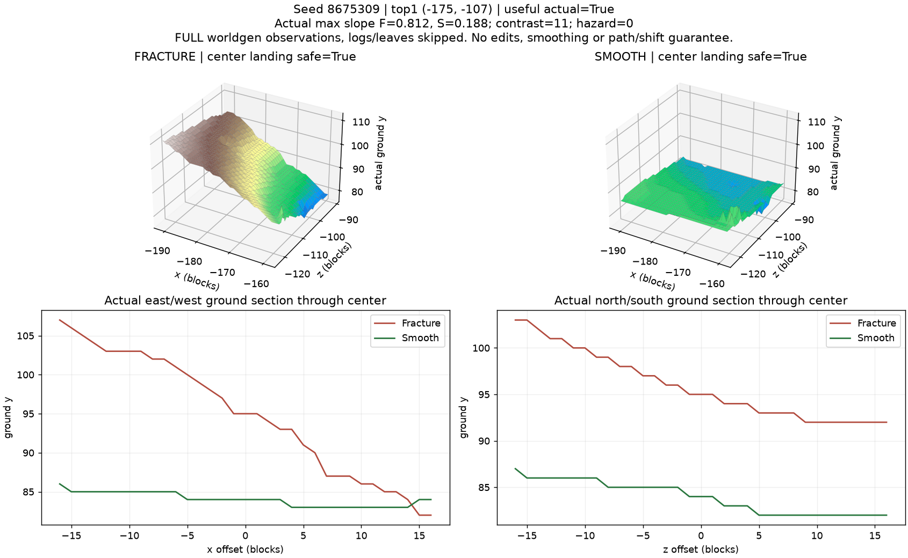
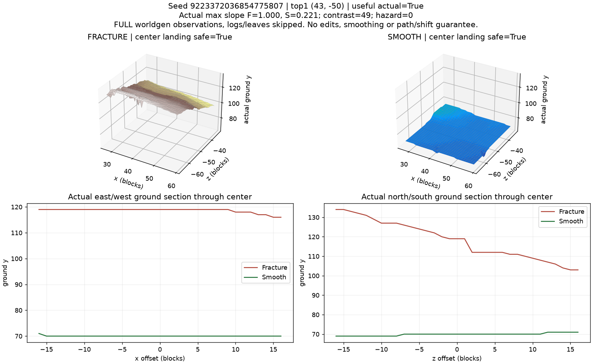
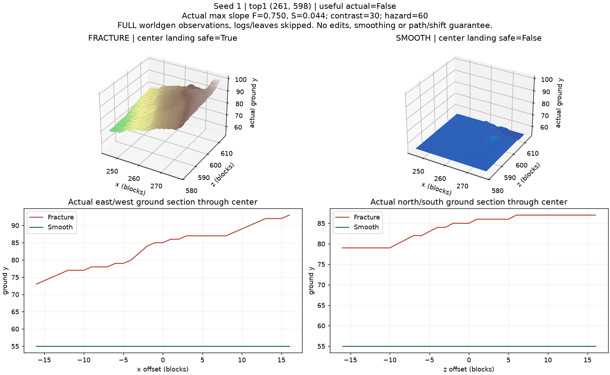
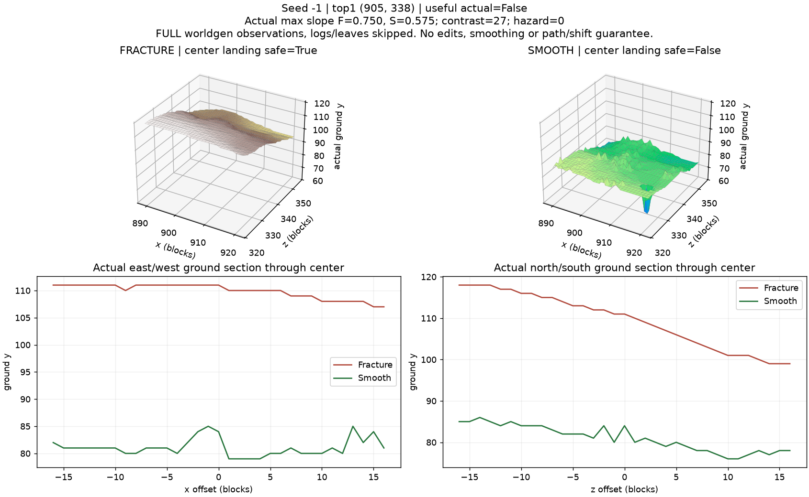

# WPH-013 ten-seed acceptance — 2026-10-09

**Automated correctness: PASS. Useful actual Top1: 2/10.** The
**7/10 majority target is NOT met**. This is a negative quality experiment with
a functioning bounded diagnostic prototype, not a claim of a ready tutorial.
No thresholds, seeds, count, radius or worldgen presets were changed to disguise
the shortfall. Quality is reported separately as `QUALITY_SHORTFALL`.

Minecraft26.1 / NeoForge26.1.0.19-beta / Temurin25.0.3+9-LTS, Windows x64.
Final sequence/ranking version3, radius512,64 centers,18 base columns/candidate,
minimum retained spacing64. The center is each fresh world's actual Overworld
shared spawn. Criteria were fixed in the [validation plan](TUTORIAL_SEARCH_VALIDATION_PLAN.md)
before running the experiments. [API/formula details](TUTORIAL_SEARCH.md).

## Per-seed actual Top1

F/S heights below are base heights followed by actual FULL ground heights.
Actual slopes/hazard and both center safety checks determine the outcome.
All ten repeat rankings and independently checked Top5 generator columns pass.

| Seed | Spawn x,z | Top1 x,z | Base F/S | FULL F/S | FULL slopes F/S | FULL hazard | Useful | Reason |
| --- | --- | --- | --- | --- | --- | ---: | --- | --- |
| 0 | -32,0 | -47,-227 | 72/69 | 72/69 | 0.375/0.062 | 0 | FAIL | height contrast <4 |
| 1 | 160,160 | 261,598 | 85/55 | 85/55 | 0.750/0.044 | 60 | FAIL | sea/coast/vertical/cliff hazard hint; SMOOTH center not safe |
| -1 | 496,384 | 905,338 | 111/80 | 111/84 | 0.750/0.575 | 0 | FAIL | Smooth slope >0.25; slope improvement <0.25; SMOOTH center not safe |
| 42 | -32,0 | 211,-158 | 86/63 | 86/63 | 0.663/0.088 | 60 | FAIL | sea/coast/vertical/cliff hazard hint |
| 8675309 | 16,80 | -175,-107 | 95/84 | 95/84 | 0.812/0.188 | 0 | PASS | All frozen criteria pass; route/actual bounded shift unproven |
| 20261009 | 0,0 | 125,311 | 25/72 | 25/72 | 1.500/0.309 | 60 | FAIL | Smooth slope >0.25; sea/coast/vertical/cliff hazard hint; FRACTURE center not safe |
| 123456789 | 64,-48 | -213,-356 | 24/66 | 24/59 | 2.125/0.875 | 150 | FAIL | Smooth slope >0.25; sea/coast/vertical/cliff hazard hint; FRACTURE center not safe; SMOOTH center not safe |
| 987654321 | 0,0 | -140,46 | 83/63 | 83/63 | 0.750/0.309 | 60 | FAIL | Smooth slope >0.25; sea/coast/vertical/cliff hazard hint |
| -7046029254386353131 | 0,0 | -287,235 | 81/60 | 81/60 | 0.750/0.188 | 60 | FAIL | sea/coast/vertical/cliff hazard hint; SMOOTH center not safe |
| 9223372036854775807 | 0,0 | 43,-50 | 119/70 | 119/70 | 1.000/0.221 | 0 | PASS | All frozen criteria pass; route/actual bounded shift unproven |

## Top5 base scores for every seed

Positive contributions and subtractive penalties are shown separately.
Slope contrast is signed Fracture minus Smooth; height contrast is absolute.
All rows are measured base columns, not final terrain/landing certifications.

### Seed 0

| Rank | x,z | Height F/S | Slope F/S | H | F-S | Distance | Height + | Slope + | Distance - | Hazard - | Total | Base useful |
| ---: | --- | --- | --- | ---: | ---: | ---: | ---: | ---: | ---: | ---: | ---: | --- |
| 1 | -47,-227 | 72/69 | 0.375/0.062 | 3 | 0.312 | 227.5 | 0.562 | 20.000 | 5.332 | 0 | 15.231 | False |
| 2 | 80,238 | 85/72 | 0.875/0.438 | 13 | 0.438 | 263.0 | 2.438 | 4.000 | 6.165 | 0 | 0.273 | False |
| 3 | 238,218 | 87/65 | 0.795/0.188 | 22 | 0.608 | 347.0 | 4.125 | 38.912 | 8.133 | 60 | -25.097 | False |
| 4 | -44,-499 | 32/55 | 1.750/0.177 | 23 | 1.573 | 499.1 | 4.312 | 100.686 | 11.699 | 120 | -26.700 | False |
| 5 | -508,44 | 78/60 | 0.575/0.062 | 18 | 0.512 | 478.0 | 3.375 | 32.770 | 11.204 | 60 | -35.059 | False |

### Seed 1

| Rank | x,z | Height F/S | Slope F/S | H | F-S | Distance | Height + | Slope + | Distance - | Hazard - | Total | Base useful |
| ---: | --- | --- | --- | ---: | ---: | ---: | ---: | ---: | ---: | ---: | ---: | --- |
| 1 | 261,598 | 85/55 | 0.750/0.044 | 30 | 0.706 | 449.5 | 5.625 | 45.172 | 10.535 | 60 | -19.738 | False |
| 2 | 299,545 | 94/54 | 0.619/0.177 | 40 | 0.442 | 409.3 | 6.000 | 28.284 | 9.594 | 60 | -35.309 | False |
| 3 | 579,409 | 99/66 | 0.530/0.125 | 33 | 0.405 | 487.4 | 6.000 | 25.941 | 11.424 | 60 | -39.482 | False |
| 4 | 643,186 | 109/56 | 0.663/0.312 | 53 | 0.350 | 483.7 | 6.000 | 14.426 | 11.337 | 60 | -50.910 | False |
| 5 | 483,482 | 109/59 | 0.375/0.188 | 50 | 0.188 | 456.1 | 6.000 | 12.000 | 10.689 | 60 | -52.689 | False |

### Seed -1

| Rank | x,z | Height F/S | Slope F/S | H | F-S | Distance | Height + | Slope + | Distance - | Hazard - | Total | Base useful |
| ---: | --- | --- | --- | ---: | ---: | ---: | ---: | ---: | ---: | ---: | ---: | --- |
| 1 | 905,338 | 111/80 | 0.750/0.398 | 31 | 0.352 | 411.6 | 5.812 | 3.632 | 9.646 | 0 | -0.201 | False |
| 2 | 966,270 | 118/80 | 0.133/0.062 | 38 | 0.070 | 483.6 | 6.000 | -5.858 | 11.335 | 0 | -11.193 | False |
| 3 | 748,441 | 80/63 | 0.619/0.044 | 17 | 0.575 | 258.4 | 3.188 | 36.770 | 6.055 | 60 | -26.098 | False |
| 4 | 342,347 | 86/54 | 0.530/0.133 | 32 | 0.398 | 158.4 | 6.000 | 25.456 | 3.712 | 60 | -32.256 | False |
| 5 | 243,281 | 89/57 | 0.500/0.133 | 32 | 0.367 | 273.2 | 6.000 | 23.515 | 6.402 | 60 | -36.888 | False |

### Seed 42

| Rank | x,z | Height F/S | Slope F/S | H | F-S | Distance | Height + | Slope + | Distance - | Hazard - | Total | Base useful |
| ---: | --- | --- | --- | ---: | ---: | ---: | ---: | ---: | ---: | ---: | ---: | --- |
| 1 | 211,-158 | 86/63 | 0.663/0.088 | 23 | 0.575 | 289.8 | 4.312 | 36.770 | 6.793 | 60 | -25.711 | False |
| 2 | 40,-245 | 88/66 | 0.562/0.188 | 22 | 0.375 | 255.4 | 4.125 | 24.000 | 5.985 | 60 | -37.860 | False |
| 3 | -325,-292 | -2/60 | 1.458/0.125 | 62 | 1.333 | 413.7 | 6.000 | 85.338 | 9.695 | 120 | -38.357 | False |
| 4 | 113,-181 | 96/63 | 0.575/0.265 | 33 | 0.309 | 231.9 | 6.000 | 17.858 | 5.436 | 60 | -41.578 | False |
| 5 | -24,-274 | 85/62 | 0.562/0.250 | 23 | 0.312 | 274.1 | 4.312 | 20.000 | 6.425 | 60 | -42.112 | False |

### Seed 8675309

| Rank | x,z | Height F/S | Slope F/S | H | F-S | Distance | Height + | Slope + | Distance - | Hazard - | Total | Base useful |
| ---: | --- | --- | --- | ---: | ---: | ---: | ---: | ---: | ---: | ---: | ---: | --- |
| 1 | -175,-107 | 95/84 | 0.812/0.188 | 11 | 0.625 | 267.3 | 2.062 | 40.000 | 6.265 | 0 | 35.798 | True |
| 2 | 312,14 | 103/61 | 1.149/0.125 | 42 | 1.024 | 303.3 | 6.000 | 65.539 | 7.108 | 60 | 4.431 | False |
| 3 | 220,225 | 99/54 | 1.188/0.250 | 45 | 0.938 | 250.3 | 6.000 | 60.000 | 5.866 | 60 | 0.134 | False |
| 4 | -58,214 | 70/78 | 0.938/0.133 | 8 | 0.805 | 153.1 | 1.500 | 51.515 | 3.588 | 60 | -10.573 | False |
| 5 | -300,-19 | 112/72 | 1.562/0.442 | 40 | 1.121 | 331.1 | 6.000 | 47.147 | 7.761 | 60 | -14.614 | False |

### Seed 20261009

| Rank | x,z | Height F/S | Slope F/S | H | F-S | Distance | Height + | Slope + | Distance - | Hazard - | Total | Base useful |
| ---: | --- | --- | --- | ---: | ---: | ---: | ---: | ---: | ---: | ---: | ---: | --- |
| 1 | 125,311 | 25/72 | 1.500/0.309 | 47 | 1.191 | 335.2 | 6.000 | 68.603 | 7.856 | 60 | 6.747 | False |
| 2 | 395,-259 | 101/69 | 0.309/0.125 | 32 | 0.184 | 472.3 | 6.000 | 8.998 | 11.070 | 0 | 3.928 | False |
| 3 | 168,40 | 99/62 | 0.884/0.088 | 37 | 0.795 | 172.7 | 6.000 | 50.912 | 4.048 | 60 | -7.136 | False |
| 4 | 376,-165 | 95/81 | 0.250/0.221 | 14 | 0.029 | 410.6 | 2.625 | -3.475 | 9.624 | 0 | -10.474 | False |
| 5 | 210,98 | 99/63 | 0.750/0.125 | 36 | 0.625 | 231.7 | 6.000 | 40.000 | 5.431 | 60 | -19.431 | False |

### Seed 123456789

| Rank | x,z | Height F/S | Slope F/S | H | F-S | Distance | Height + | Slope + | Distance - | Hazard - | Total | Base useful |
| ---: | --- | --- | --- | ---: | ---: | ---: | ---: | ---: | ---: | ---: | ---: | --- |
| 1 | -213,-356 | 24/66 | 2.125/0.438 | 42 | 1.688 | 414.2 | 6.000 | 84.000 | 9.709 | 90 | -9.709 | False |
| 2 | -192,0 | 81/69 | 0.562/0.438 | 12 | 0.125 | 260.5 | 2.250 | -16.000 | 6.105 | 0 | -19.855 | False |
| 3 | 255,304 | 104/63 | 0.750/0.250 | 41 | 0.500 | 400.5 | 6.000 | 32.000 | 9.386 | 60 | -31.386 | False |
| 4 | 51,-474 | 39/69 | 0.486/0.133 | 30 | 0.354 | 426.2 | 5.625 | 22.627 | 9.989 | 60 | -41.737 | False |
| 5 | -122,256 | 103/64 | 0.562/0.250 | 39 | 0.312 | 356.4 | 6.000 | 20.000 | 8.353 | 60 | -42.353 | False |

### Seed 987654321

| Rank | x,z | Height F/S | Slope F/S | H | F-S | Distance | Height + | Slope + | Distance - | Hazard - | Total | Base useful |
| ---: | --- | --- | --- | ---: | ---: | ---: | ---: | ---: | ---: | ---: | ---: | --- |
| 1 | -140,46 | 83/63 | 0.750/0.088 | 20 | 0.662 | 147.4 | 3.750 | 42.343 | 3.454 | 60 | -17.361 | False |
| 2 | 122,108 | 79/63 | 0.500/0.133 | 16 | 0.367 | 162.9 | 3.000 | 23.515 | 3.819 | 60 | -37.304 | False |
| 3 | 221,-18 | 92/65 | 0.530/0.250 | 27 | 0.280 | 221.7 | 5.062 | 17.941 | 5.197 | 60 | -42.193 | False |
| 4 | -366,61 | 97/63 | 0.442/0.177 | 34 | 0.265 | 371.0 | 6.000 | 16.971 | 8.696 | 60 | -45.726 | False |
| 5 | 395,1 | 90/62 | 0.354/0.133 | 28 | 0.221 | 395.0 | 5.250 | 13.227 | 9.258 | 60 | -50.781 | False |

### Seed -7046029254386353131

| Rank | x,z | Height F/S | Slope F/S | H | F-S | Distance | Height + | Slope + | Distance - | Hazard - | Total | Base useful |
| ---: | --- | --- | --- | ---: | ---: | ---: | ---: | ---: | ---: | ---: | ---: | --- |
| 1 | -287,235 | 81/60 | 0.750/0.188 | 21 | 0.562 | 370.9 | 3.938 | 36.000 | 8.694 | 60 | -28.756 | False |
| 2 | 285,-296 | 83/57 | 0.619/0.133 | 26 | 0.486 | 410.9 | 4.875 | 31.113 | 9.631 | 60 | -33.643 | False |
| 3 | 396,-270 | 77/55 | 0.625/0.125 | 22 | 0.500 | 479.3 | 4.125 | 32.000 | 11.233 | 60 | -35.108 | False |
| 4 | -47,272 | 85/61 | 0.375/0.062 | 24 | 0.312 | 276.0 | 4.500 | 20.000 | 6.469 | 60 | -41.969 | False |
| 5 | 386,-153 | 99/56 | 0.530/0.250 | 43 | 0.280 | 415.2 | 6.000 | 17.941 | 9.732 | 60 | -45.791 | False |

### Seed 9223372036854775807

| Rank | x,z | Height F/S | Slope F/S | H | F-S | Distance | Height + | Slope + | Distance - | Hazard - | Total | Base useful |
| ---: | --- | --- | --- | ---: | ---: | ---: | ---: | ---: | ---: | ---: | ---: | --- |
| 1 | 43,-50 | 119/70 | 1.000/0.221 | 49 | 0.779 | 65.9 | 6.000 | 49.858 | 1.546 | 0 | 54.312 | True |
| 2 | -259,96 | 88/76 | 0.795/0.265 | 12 | 0.530 | 276.2 | 2.250 | 32.000 | 6.474 | 0 | 27.776 | False |
| 3 | 120,-78 | 109/68 | 1.282/0.312 | 41 | 0.969 | 143.1 | 6.000 | 54.024 | 3.354 | 60 | -3.330 | False |
| 4 | -145,-421 | 102/64 | 1.250/0.265 | 38 | 0.985 | 445.3 | 6.000 | 61.088 | 10.436 | 60 | -3.348 | False |
| 5 | -199,-246 | 83/87 | 1.061/0.133 | 4 | 0.928 | 316.4 | 0.750 | 59.397 | 7.416 | 60 | -7.269 | False |


## Observed terrain and evidence boundaries

The probe generated real FULL chunks only after base searches and commands had
completed without FULL requests. These are natural worldgen patches, with no
platforms, block edits or preset tuning. Ground observations cover33x33 blocks,
skip logs/leaves above ground, and reuse real LandingSafety for supported body
space at each Phase's actual center surface. They are data observations, not
native-client rendered screenshots and not path/Phase Shift acceptance.

Every seed's Top1 and low-ranked seed0/42 patches were plotted with
`tools/render_tutorial_observations.py`. Curated review figures:









These plots use the same vertical scale for both Phase surfaces; they do not
smooth, edit or replace measured values. Center ground-block composition and
support/collision decisions remain in the ignored JSON report.

The successes have visibly larger Fracture relief while Smooth is gentler and
the two center standing positions are supported and safe. They only pass the
frozen local terrain proxy. Their height offsets can exceed gameplay +/-4:
a player cannot be assumed to shift safely at the exact center. No continuous
route, intermediate footholds, cave geometry or two-endpoint transfer is proven.

Failures include Smooth sea/coast candidates whose low slope describes a seabed,
Smooth that remains too steep, weak Fracture obstacles and base/final terrain
disagreement. Seed0's Top1 is a near miss (height contrast3), not rescued by
lowering the required4. Seed1's Smooth ground is below sea level and its center
fails real landing safety. Seed-1 illustrates that a coarse base-column signal
can disagree with final ground/standing safety. Low-ranked seed0/42 examples
also fail the same criteria and are diagnostic failures, not counted successes.

## Local performance

Compute is the sum of bounded sampling/scoring batches, excluding scheduling
waits and the later FULL observation. Unit tests make no timing assertions.
The isolated measurement probe deliberately runs4-column batches back-to-back;
its bulk tick lag warnings are not normal2-column command latency evidence.

| Seed | 64 height calls | 64 compute ms | 64 max4-column batch ms | 256 height calls | 256 compute ms | 256 max4-column batch ms |
| --- | ---: | ---: | ---: | ---: | ---: | ---: |
| 0 | 1152 | 7681.9 | 66.5 | 4608 | 28122.0 | 47.1 |
| 1 | 1144 | 7144.4 | 51.1 | 4588 | 29077.7 | 39.4 |
| -1 | 1152 | 9537.8 | 64.4 | 4604 | 34532.9 | 102.2 |
| 42 | 1144 | 8767.1 | 50.1 | 4600 | 32369.8 | 47.0 |
| 8675309 | 1152 | 7544.5 | 40.9 | 4608 | 28294.6 | 38.8 |
| 20261009 | 1152 | 8266.1 | 50.5 | 4608 | 30576.1 | 44.6 |
| 123456789 | 1152 | 8043.5 | 66.7 | 4592 | 28189.4 | 38.9 |
| 987654321 | 1144 | 7220.1 | 56.5 | 4598 | 27898.7 | 41.9 |
| -7046029254386353131 | 1152 | 7934.5 | 41.6 | 4608 | 30319.4 | 38.4 |
| 9223372036854775807 | 1148 | 7548.9 | 65.1 | 4604 | 27299.4 | 37.1 |

All basic searches and command diagnostics leave Phase loaded-chunk counts
unchanged (zero FULL requests); mock invocation audits also prohibit chunk/live
heightmap access. Maximum work remains <=4608 service calls/256 centers.
The actual production command runs2 columns/tick: default64 needs576 ticks
(about28.8 seconds at20TPS), max256 needs2304 ticks (about115.2 seconds).
One active search per server bounds contention. A slow individual generator
call can still exceed a tick budget; no hard CPU-time promise is made.

## Actual registered command output

The dedicated probe uses a real OP ServerPlayer and registered Brigadier tree.
Only outbound transport is discarded. It checks no wp ambiguity, no player
movement, readable component output and command completion through real ticks.
First nine seeds exercise find8; the last exercises the actual find256 maximum.
The preceding isolated bulk measurement leaves tick debt, so catch-up ticks can
make the captured command wall time shorter than the steady20TPS estimate.
The real2-column batch measurement remains valid; these wall times are not a
claim that an ordinary command finishes instantaneously or a portable latency SLA.
Representative seed8675309 score/find output (exact captured text):

```text
[wp] tutorial score seed=8675309 center=Overworld shared spawn (16,80) radius=512 samples=18 computeMs=113.18; base heuristic, no FULL chunks/path proof
[wp] #1 x=16 z=80 F=19 S=59 | slope F=0.438 S=0.188 contrast=+0.250 | heightContrast=40.0
[wp] total=-98.00 height=+6.00 slope=+16.00 distancePenalty=0.00 hazardPenalty=120.00 distance=0.0 usefulHeuristic=false (not landing/path validation)
[wp] tutorial find started center=Overworld shared spawn (16,80) radius=512 candidates=8; at most two height columns/tick, no FULL chunks, no teleport
[wp] tutorial find seed=8675309 center=(16,80) radius=512 evaluated=8 spaced=8 heightSamples=144 computeMs=793.40 wallMs=809.98 maxBatchMs=15.82; heuristic only
[wp] #1 x=220 z=225 F=99 S=54 | slope F=1.188 S=0.250 contrast=+0.938 | heightContrast=45.0
[wp] total=+0.13 height=+6.00 slope=+60.00 distancePenalty=5.87 hazardPenalty=60.00 distance=250.3 usefulHeuristic=false (not landing/path validation)
[wp] #2 x=222 z=370 F=115 S=67 | slope F=0.563 S=0.133 contrast=+0.430 | heightContrast=48.0
```

Actual max-count completion header (last seed):

```text
[wp] tutorial find seed=9223372036854775807 center=(0,0) radius=512 evaluated=256 spaced=89 heightSamples=4604 computeMs=32344.45 wallMs=107686.56 maxBatchMs=25.71; heuristic only
```

## Tests and retained regression

```sh
./gradlew test --tests '*tutorial*' --tests '*WorldPhaseCommandTest' --tests '*TerrainSampleServiceTest' --console=plain --no-build-cache
./gradlew coreRegression build tutorialVerification --console=plain --no-build-cache
./gradlew coreRegressionAll build --console=plain --no-build-cache
```

Focused tests:115 passed (26 Finder,8 Score,50 command,31 sampling).
Complete core/build:334 passed, zero failures/errors/skips, retaining original287.
This includes34 noise goldens,51 density/codec,29 Phase domain,10 preset,
45 transfer,35 landing,8 profiler and7 core-ledger tests. The47 additions
include hand-built scoring direction/hazards, finite/extreme heights, a small
hash-sequence golden prefix, deterministic ordering/ties/prefixes, de-duplication,
bounds/thread/seed/missing-Level checks, no extra chunks, command OP/console/
parameter checks, batching, cancellation and recovery after a failed batch.

The ten-seed dedicated task passes correctness, repeats and generator checks,
but separately reports usefulTop1=2/10 and majorityMet=false.
Every server saves/stops normally. The unchanged core dedicated cold/reload
regression also passes100 complete cycles/400 loop shifts, player identity/
inventory/entity uniqueness and actual persistence. No new tutorial persistence
or native-client UI acceptance is claimed.

Production JAR inspection excludes phaseVerification, test and profiler classes.
Kernels/goldens, PhaseDefinition, presets, TerrainSampleService, transfer/landing
policies and existing wp command behavior have no production changes.

## Experiments, deviations and next boundary

The uniform sequence with pure score ranking first yielded2/10. A predeclared
inner-half/full-disk alternating refinement yielded0/10 and was rejected.
Final version3 retains uniform points and puts the unchanged base-qualified
predicate before score ranking; it yields2/10 under the unchanged standard.
No repeated-seed replacement or threshold relaxation occurred. The problem is
candidate quality under existing terrain, not failed sampling or determinism.

TechnicalDesign's prototype scope is preserved. Actual26.1 development spawn
access uses Overworld LevelData.RespawnData; find is incremental because measured
synchronous work would block ticks. No production bug, compatibility hack,
preset tuning or transfer behavior change was required. Village#25 stays separate.

#14 interface suggestions are recorded in TUTORIAL_SEARCH.md only. Before
treating a stored selection as a usable tutorial, review this quality shortfall
and define validation/version invalidation explicitly. This PR neither starts
#14 nor silently makes negative candidates into selected locations.
