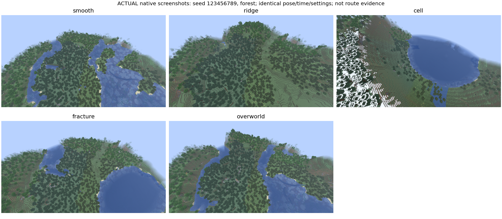
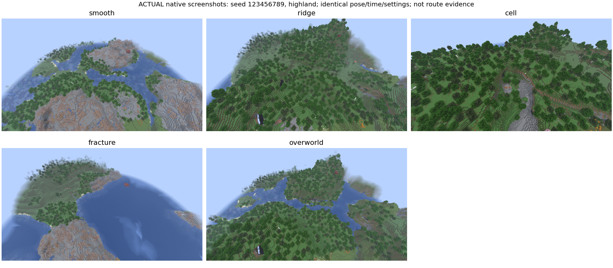
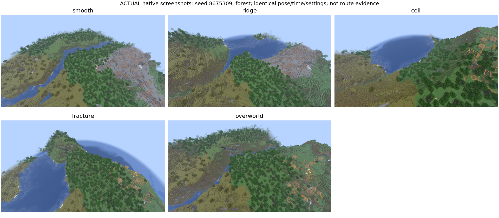
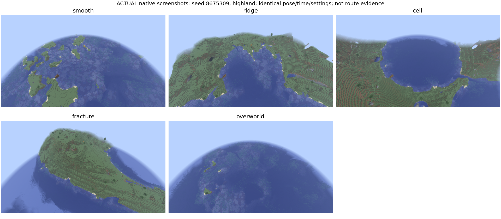
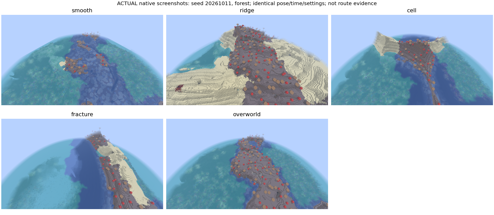
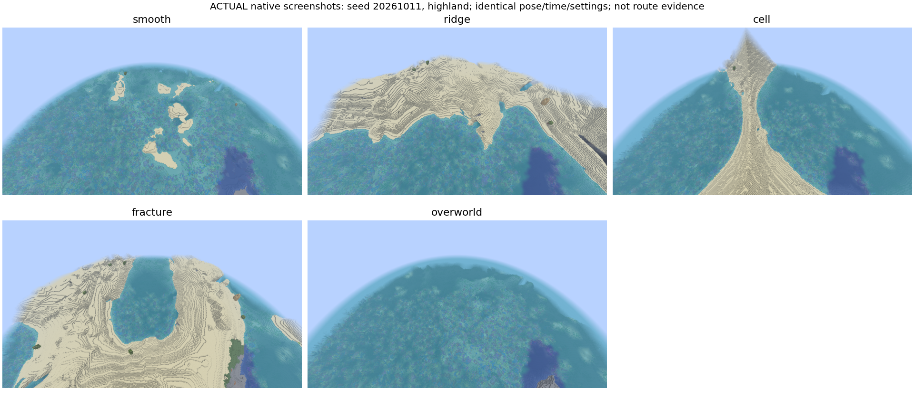

# 原生客户端固定视角观察

**SCRIPTED_NATIVE_OBSERVATION，不是human-playtested，不是ROUTE_COMPLETED。**
这是Linux上真实Minecraft26.1 / NeoForge26.1.0.19-beta渲染与截图，非合成场景或艺术效果图。
最终30张原始1280×720 PNG保存在native/；contact sheet仅用于并排索引，原图未裁剪/改色。
每个窗口的五个世界包括Overworld控制组，不删除海洋/普通区域。

固定第一人称Spectator相机：玩家脚位置y240（正常站立eye offset），x/z为窗口中心+0.5；
yaw135、pitch60、FOV70；时间6000、clear、冻结时钟/天气；render16/simulation5；
Fancy作为基础后覆盖cloudsOFF、particlesMINIMAL、gamma0.5，实际UI显示CUSTOM。
AO=true、mipmap4、biomeBlend2、Vanilla资源；选定options另存于各seed measurements/selected-options.json。
视角保持相同，不因某个Phase山高或海多而换位置。高地近镜头、树林遮挡与水面覆盖会影响肉眼识别，
这是这个固定观察协议的局限；height/density图使用独立的同坐标格网，不把像素面积当相同地面面积。

每图至少379 client ticks：先360，再编译队列/inner10chunk圆盘已加载且稳定20tick。
seed0/1最终整组补拍使用dev-only ComputeCameraAngles固定姿态，防止输入改变镜头；
seed2原轮姿态本已逐图满足135/60，保留原轮。没有改变seed、窗口、相机协议或生产配置。
详细position/time/weather/subsettings/settle值见measurements/*/spatial-client.json。

## 六窗口逐组判读

| seed / window | Smooth | Ridge | Cell | Fracture | 对照与限制 |
|---|---|---|---|---|---|
| 123456789 forest | 森林较平，河道两侧和东侧大片水面，像普通低丘森林 | 森林隆起、圆顶丘和细密坡面，未见明显主方向连续山墙 | 巨大近圆水盆，周围高壁/局部雪线，强高差但不是清晰蜂窝组 | 森林岸线和河口变化，仍很像普通森林/水岸，无可确认断层面 | Overworld同样森林、河流、丘陵；四图共同材质/树种/天空很强 |
| 123456789 highland | 宽水道与低起伏，大片裸石在较低地形上，biome/高度错配可见 | 绿地山丘和较尖山顶，谷地存在，方向性不足以据此确认长脊 | 高壁/裸石切口明显，局部盆缘，但未出现规则多边形平台网络 | 大片水面和弯曲坡岸，有陡崖/局部熔岩可见，未证实错位岩层 | Overworld中型丘陵与河谷；Smooth裸石和Fracture水域不能挑走 |
| 8675309 forest | 森林/草原与细长水道，宽缓低地、裸石坡 | 草原山丘与水盆，略大高差，但与Vanilla山丘家族相似 | 大盆地和高坡，边缘村庄可见；不是已证明结构安全 | 长水岸/狭长陆块，村庄跨坡，地形变化强于色彩变化 | 四Phase仍共享明显biome分区；村庄远景不能证明村民无窒息 |
| 8675309 highland | 海洋/浅水占多数、少量低岛，这是表现不明显样本 | 较大环湾陆块、抬升岸坡；不是明确长山墙走廊 | 大圆形水盆与陡缘，中心区域仍被水覆盖 | 高起伏不规则半岛/岛岸，密集阶梯坡，无断层可证 | Overworld主要海洋；不换成漂亮内陆坐标，统计另列inland子集 |
| 20261011 forest | 低蘑菇岛/浅海，水覆盖显著 | 相同蘑菇/沙滩生态被抬高，像更大岛丘，未见主方向山脊 | 高起伏单元与水面分区，岛屿局部被截；未形成清晰蜂窝盆组 | 狭长蘑菇/沙岸与深色水道，局部陡岸；无可确认岩体错位 | 蘑菇群系视觉极强，同biome掩盖噪声身份；不能把biome特征归功于Phase |
| 20261011 highland | 海底/珊瑚和几个低沙岛，最像普通海洋，宽谷身份看不出来 | 大沙地陆块与海湾，整体抬升、坡面较碎 | 狭长沙脊/高墙和水域，局部可辨单元边缘；未见多边形平台网络 | 近环形水盆/沙坡，明显起伏但也像普通环湖地形 | Overworld为海洋；不能据这张环形地形把Fracture叫作“有断层” |

以上是图像与量化数据的审阅观察，未声称在这些图中完成了Survival行走或安全Shift。
树林遮挡的坡底、洞口是否可进、村民是否受伤不在这一固定航拍协议的证明范围。
#25和#33继续独立追踪；本轮没有修复它们，也没有根据远景截图虚报已解决。

## 索引

### 123456789 / forest

[smooth原图](native/wph016-123456789-forest-smooth.png) · [ridge原图](native/wph016-123456789-forest-ridge.png) · [cell原图](native/wph016-123456789-forest-cell.png) · [fracture原图](native/wph016-123456789-forest-fracture.png) · [overworld原图](native/wph016-123456789-forest-overworld.png)

### 123456789 / highland

[smooth原图](native/wph016-123456789-highland-smooth.png) · [ridge原图](native/wph016-123456789-highland-ridge.png) · [cell原图](native/wph016-123456789-highland-cell.png) · [fracture原图](native/wph016-123456789-highland-fracture.png) · [overworld原图](native/wph016-123456789-highland-overworld.png)

### 8675309 / forest

[smooth原图](native/wph016-8675309-forest-smooth.png) · [ridge原图](native/wph016-8675309-forest-ridge.png) · [cell原图](native/wph016-8675309-forest-cell.png) · [fracture原图](native/wph016-8675309-forest-fracture.png) · [overworld原图](native/wph016-8675309-forest-overworld.png)

### 8675309 / highland

[smooth原图](native/wph016-8675309-highland-smooth.png) · [ridge原图](native/wph016-8675309-highland-ridge.png) · [cell原图](native/wph016-8675309-highland-cell.png) · [fracture原图](native/wph016-8675309-highland-fracture.png) · [overworld原图](native/wph016-8675309-highland-overworld.png)

### 20261011 / forest

[smooth原图](native/wph016-20261011-forest-smooth.png) · [ridge原图](native/wph016-20261011-forest-ridge.png) · [cell原图](native/wph016-20261011-forest-cell.png) · [fracture原图](native/wph016-20261011-forest-fracture.png) · [overworld原图](native/wph016-20261011-forest-overworld.png)

### 20261011 / highland

[smooth原图](native/wph016-20261011-highland-smooth.png) · [ridge原图](native/wph016-20261011-highland-ridge.png) · [cell原图](native/wph016-20261011-highland-cell.png) · [fracture原图](native/wph016-20261011-highland-fracture.png) · [overworld原图](native/wph016-20261011-highland-overworld.png)

## 排除的尝试与性能口径

第一次设置不匹配（Fancy覆盖sim为12）被中断排除。第二次虽完成30张，但严格validator发现
seed123456789/highland/overworld yaw133.65007 pitch64.350006，以及
seed8675309/highland/ridge yaw145.64998 pitch54.749996；因此该两seed整组均未作为最终基准。
原始report、图和日志保留ignored run/history；排除摘要见excluded-attempts.json。
最后补拍固定相机，仅重跑两个受影响seed，不改地形、不重选区域，不将旧图重标为合格。

这是画面比较而非FPS benchmark。保存了逐图FPS/averageIntegratedTickMs用于上下文，
但启用VSync、maxFps120、AFK帧率限制；部分首轮图期间并行运行了plot/core regression。
不能用这些瞬时值推断GPU/完整worldgen性能。noon/clear及相机/图形一致才是这轮视觉控制项。
专用server采样CPU/wall/max-work-tick在RESULTS.md单列；未来性能门槛需无并行负载、
冷热分离、MSPT/frame-time分位数与内存/GC采样。本轮不声称已完成新架构性能验收。
